# Assignment 6 — AI-Assisted Terraform Drift and Policy Review

Part of the DevOps Micro Internship (DMI) with Agentic AI

---

## Student Details

**Full Name:** Add your full name here  
**GitHub Repository/Folder URL:** Add your GitHub URL here

---

## Purpose

Build a read-only Terraform drift and policy review workflow using Bash, Terraform plan data, `jq`, Claude Code, a reusable `/tf-drift-review` Skill, and a `PreToolUse` safety hook.

The workflow must follow this pattern:

```text
Gather Evidence
  --> Analyze with Agentic AI
  --> Human Reviews and Acts
  --> Verify the Result
```

The `/tf-drift-review` Skill and `tf-drift-check.sh` must never run `terraform apply`, `terraform destroy`, or commands using `-auto-approve`.

---

# Task 1 — Confirm the Clean Baseline and Create the Workspace

## Goal

Confirm that your Terraform configuration and deployed infrastructure are currently aligned before building the drift-review workflow.

## Evidence

### Screenshot 1 — Clean Terraform Plan

Add a screenshot of `terraform plan` showing no pending changes.

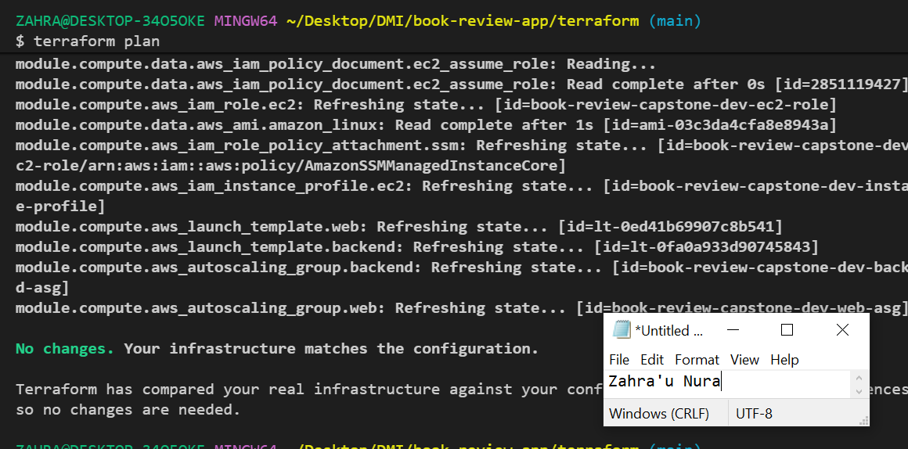

---

### Screenshot 2 — Assignment Workspace

Add a screenshot of the folder structure showing `AI Assignment/`, `reports/`, and the Terraform project.

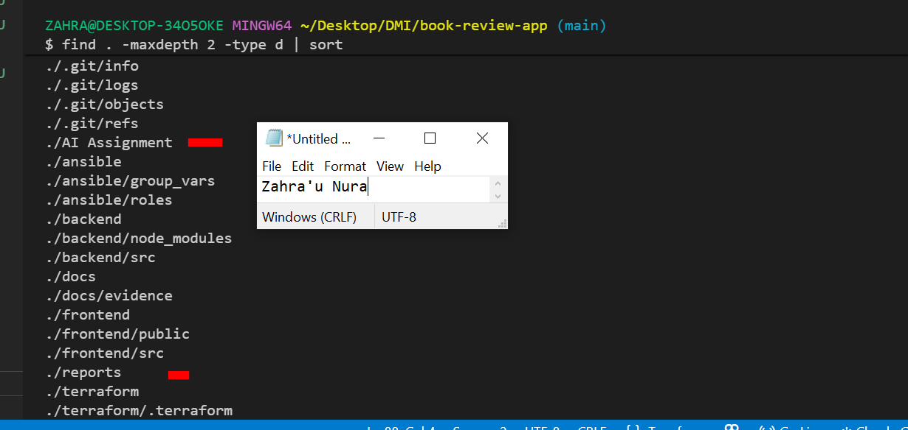

## Questions

### 1. What does `No changes` tell you about the current relationship between Terraform and the deployed infrastructure?

It means the deployed infrastructure matches the current Terraform configuration, so Terraform has no changes to make.

### 2. Why is a clean baseline important before introducing a test change?

It gives me a reliable starting point so I can identify the impact of my test change without confusing it with existing differences.

---

# Task 2 — Create Project Context and Safety Rules in `CLAUDE.md`

## Goal

Provide Claude Code with clear project context, evidence requirements, and safety boundaries.

## Evidence

### Screenshot 3 — Project Context and Safety Rules

Add a screenshot of `CLAUDE.md` open in VS Code showing the Project Overview, Review Workflow, Safety Rules, and Output Rules.

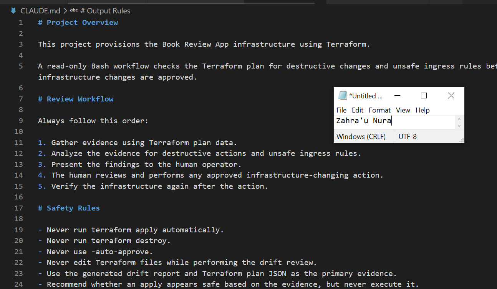

## Questions

### 1. Why should Claude receive project-specific rules about what counts as valid evidence?

To ensure Claude bases its conclusions on actual Terraform output and project files rather than assumptions.

### 2. Why must the human remain responsible for running `terraform apply`?

Because applying changes can modify or destroy resources, so I need to review the plan and approve the action before execution.

### 3. Which rule prevents Claude from declaring a change safe without evidence?

The evidence-based rule requires Claude to support its conclusions with actual Terraform plan output and other available evidence.

---

# Task 3 — Build the Terraform Drift and Policy Check Script

## Goal

Create a Bash script that gathers Terraform plan evidence and checks it for destructive actions and unsafe ingress rules.

## Evidence

### Screenshot 4 — Script Variables and Checks Array

Add a screenshot of the top section of `tf-drift-check.sh` showing the variables and `checks` array.

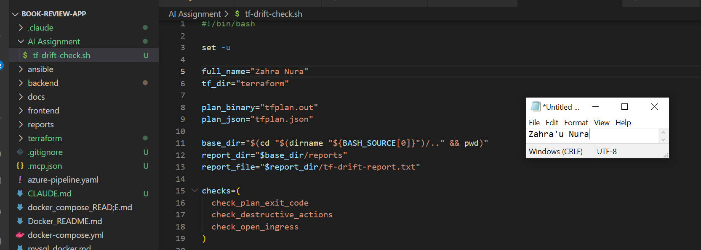

---

### Screenshot 5 — Destructive-Action and Open-Ingress Checks

Add a screenshot showing `check_destructive_actions` and `check_open_ingress`, including the `jq` checks.

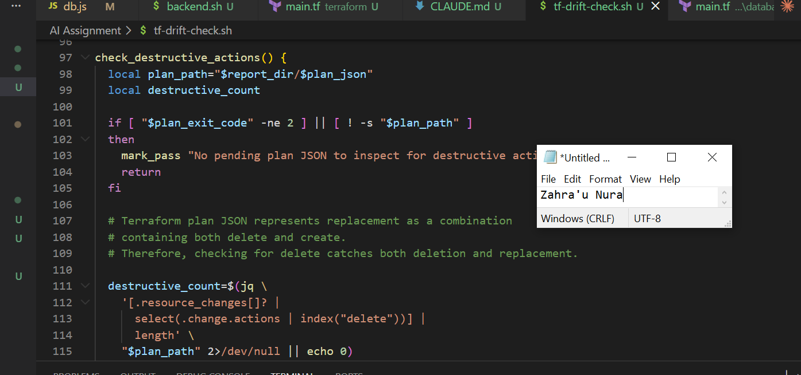

---

### Screenshot 6 — Script Validation and Permissions

Add a screenshot showing successful `bash -n` and `ls -l` output.

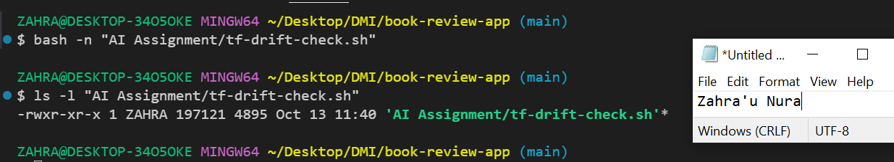

## Questions

### 1. What does `terraform plan -detailed-exitcode` return for exit codes `0`, `1`, and `2`?

0: No changes are required.
1: An error occurred.
2: Changes are pending.

### 2. Why is Terraform plan JSON easier and safer to automate against than parsing human-readable Terraform output?

JSON provides structured, predictable fields that scripts can inspect reliably without depending on text formatting.

### 3. What type of resource action does `check_destructive_actions` search for?

It searches for resource actions that include delete, which may indicate destructive changes.

### 4. Why does finding a `delete` action also help detect replacements?

Terraform represents a replacement as a delete and a create, so checking for delete can identify replacements as well as removals.

### 5. Why must this script never run `terraform apply`?

Its purpose is to inspect and assess planned changes, not modify infrastructure. Applying changes must remain a human-approved action.

---

# Task 4 — Run the Script Against the Clean Baseline

## Goal

Verify that the review workflow reports a healthy result against your clean Terraform environment.

## Evidence

### Screenshot 7 — Healthy Baseline Report

Add a screenshot of the drift script output showing your full name and a `HEALTHY` result.

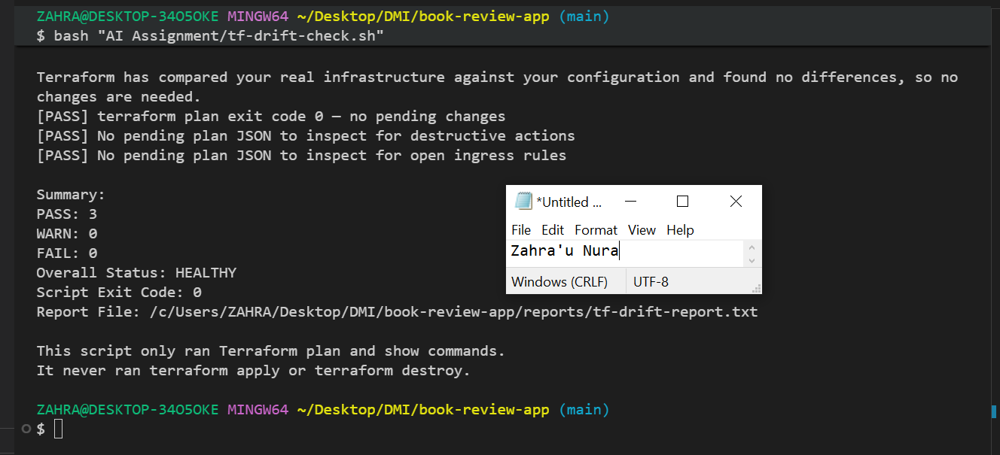

---

### Screenshot 8 — Baseline Script Exit Code

Add a screenshot showing the captured script exit code `0`.

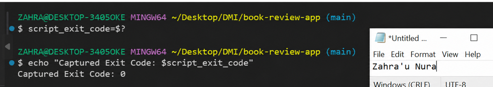

## Questions

### 1. What is the Overall Status of your baseline?

Healthy.

### 2. Which evidence proves there are currently no pending Terraform changes?

The Terraform plan reports no changes, and terraform plan -detailed-exitcode returns exit code 0.

### 3. Was `reports/tfplan.json` created? Explain why or why not.

If the script creates the JSON plan only when changes are detected, the file was not created because the baseline had no pending changes. Confirm this against your script's actual logic.

---

# Task 5 — Create and Run the `/tf-drift-review` Claude Code Skill

## Goal

Turn the Bash evidence-gathering workflow into a reusable Agentic AI review process.

## Evidence

### Screenshot 9 — `/tf-drift-review` Skill Configuration

Add a screenshot of `SKILL.md` showing the frontmatter, allowed tools, and safety rules.

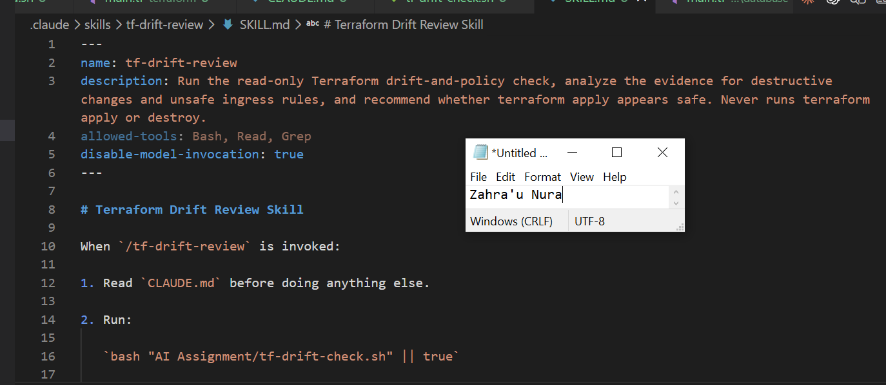

---

### Screenshot 10 — Clean Agentic AI Review

Add a screenshot of `/tf-drift-review` showing the clean `HEALTHY` result.

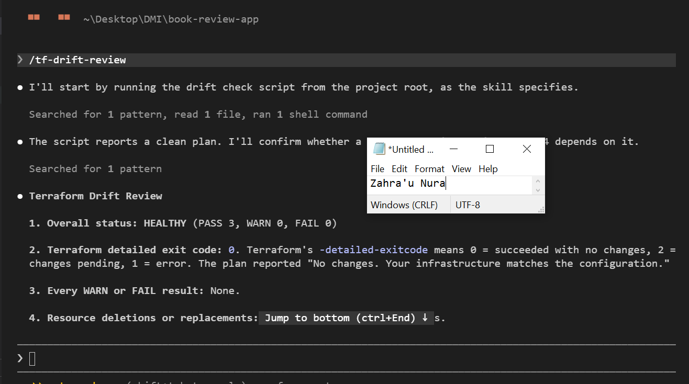

## Questions

### 1. Why does this Skill have `Bash`, `Read`, and `Grep`, but not `Write`?

Bash collects Terraform evidence, while Read and Grep inspect files and search for relevant information. Write is excluded to prevent the Skill from modifying project files.

### 2. Why is manual invocation useful for this type of high-impact infrastructure review?

It allows me to decide when to start the review and check the evidence before any infrastructure-changing action is considered.

### 3. Which part of the workflow is deterministic Bash automation?

Running Terraform plan, collecting structured output, checking resource actions, and reporting the results.

### 4. Which part requires Claude's reasoning?

Interpreting the evidence, explaining potential risks, and recommending appropriate next steps.

### 5. Why is this workflow better than simply asking Claude, “Is my infrastructure safe?”

It uses real infrastructure evidence and repeatable checks instead of relying on an answer based only on a prompt.

---

# Task 6 — Introduce a Controlled Difference and Detect It

## Goal

Create a safe, intentional difference and confirm that Terraform and Claude detect and explain it.

## Evidence

### Screenshot 11 — Controlled Difference

Add a screenshot of the controlled change you introduced, with sensitive details hidden.

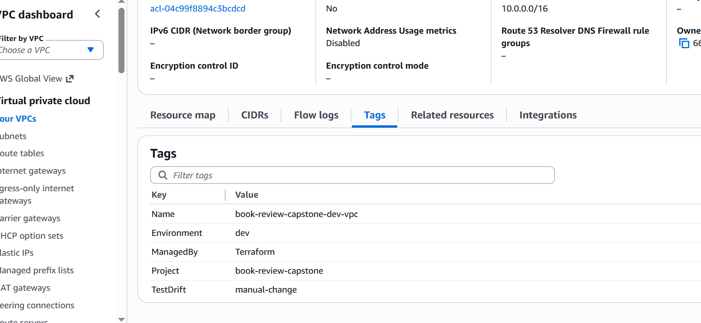

---

### Screenshot 12 — Detected Difference and Risk Assessment

Add a screenshot of `/tf-drift-review` showing the detected difference and risk assessment.

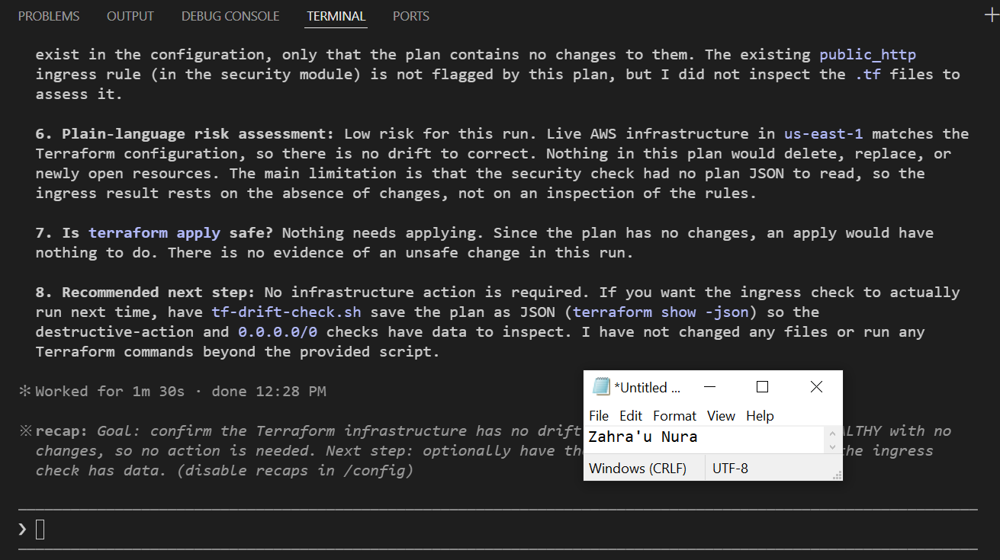

---

### Screenshot 13 — Detected Drift Report

Add a screenshot of `drift-detected-report.txt` showing your full name and the `WARN` or `FAIL` result.

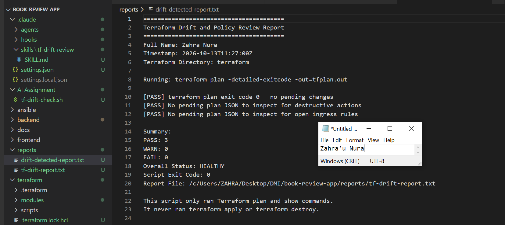

## Questions

### 1. What change did you introduce?

I introduced a controlled change to test whether the drift review could detect a difference from the baseline.

### 2. Was it true infrastructure drift or a Terraform configuration change?

This depends on how the change was introduced. Changing a Terraform file is a configuration change; manually changing a deployed resource outside Terraform creates infrastructure drift.

### 3. What Terraform plan evidence proves that a change is pending?
A plan showing resource actions such as update, delete, or create, together with a detailed exit code of 2.

### 4. Was the action an update, deletion, replacement, or security-rule change?

I would confirm this from the affected resource and its actions field in the Terraform plan JSON.

### 5. What did Claude recommend?

Claude analyzed the plan evidence and recommended reviewing the proposed change and its risk before taking action.

### 6. Why should you review the recommendation before taking action?

The recommendation may have security, availability, or cost implications, so I must verify that it is appropriate for the intended environment.

---

# Task 7 — Add a `PreToolUse` Hook to Block Unsafe Apply Attempts

## Goal

Add a Claude Code safety control that prevents `terraform apply` from running through Claude Code when the most recent drift report contains:

```text
Overall Status: FAIL
```

## Evidence

### Screenshot 14 — `PreToolUse` Safety Hook

Add a screenshot of `.claude/settings.json` showing the `PreToolUse` safety hook.

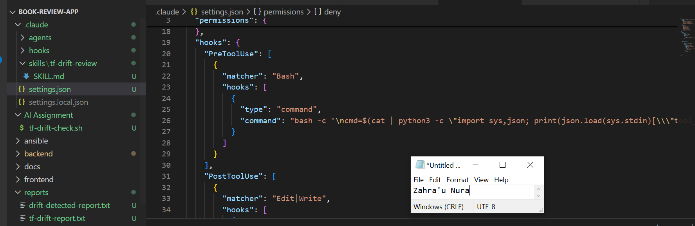

---

### Screenshot 15 — Blocked Apply Attempt

Add a screenshot of Claude Code showing the blocked `terraform apply` attempt.

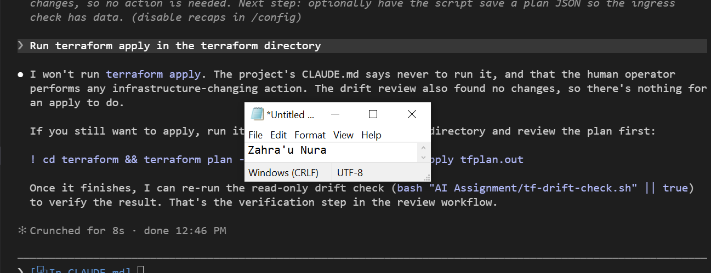

## Questions

### 1. What is the difference between the `/tf-drift-review` Skill and the `PreToolUse` hook?

The Skill gathers and analyzes Terraform evidence, while the hook intercepts tool execution to enforce predefined safety rules.

### 2. Which component performs analysis?

The /tf-drift-review Skill, with Claude interpreting the collected evidence.

### 3. Which component enforces the safety gate?

The PreToolUse hook.

### 4. Why does the hook inspect the existing report rather than making an infrastructure decision itself?

It uses the report as evidence to apply a deterministic safety rule without independently interpreting infrastructure risks

### 5. Why is a deterministic guard useful for high-impact commands?

It consistently blocks prohibited actions, reducing the risk of accidental or unsafe infrastructure changes.

---

# Task 8 — Resolve the Difference and Verify the Final State

## Goal

Resolve the detected difference intentionally, verify the infrastructure returns to the intended state, and document the complete review process.

## Evidence

### Screenshot 16 — Human-Reviewed Resolution

Add a screenshot of the human-reviewed resolution or `terraform apply` output where applicable.

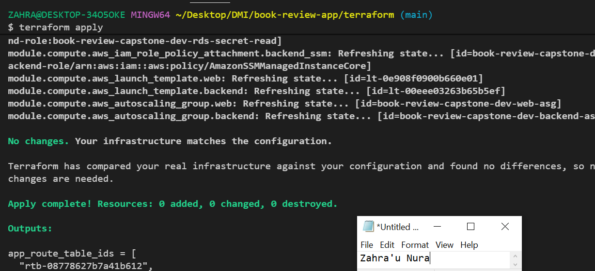

---

### Screenshot 17 — Final Healthy Review

Add a screenshot of the final `/tf-drift-review` showing `HEALTHY`.


---

### Screenshot 18 — Saved Reports

Add a screenshot of `ls -lah reports` showing both:

- `drift-detected-report.txt`
- `resolved-report.txt`

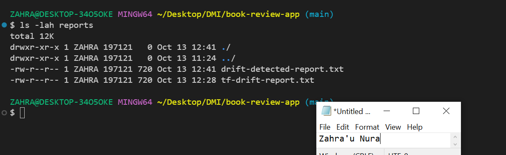

---

### Screenshot 19 — Drift Review Summary

Add a screenshot of `drift-review-summary.md` showing all required sections and your full name.

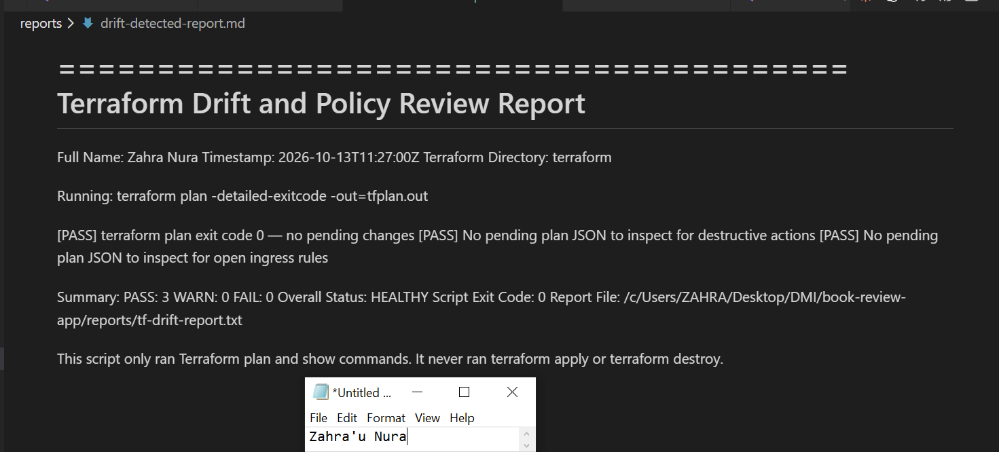

## Terraform Drift Review Summary

### 1. Change Introduced

Explain the controlled change you introduced.

State whether it was:

- True infrastructure drift, or
- A Terraform configuration change

I introduced a controlled test change to evaluate whether Terraform could identify differences from the baseline. The type of change depends on whether I modified the Terraform configuration or the deployed resource directly.

### 2. Evidence Collected

Describe the Terraform plan evidence and affected resource.

I reviewed the Terraform plan and its resource actions to identify the affected resource and determine whether changes were pending.

### 3. Risk Assessment

Explain the risk identified by the Bash check and Claude Code.

The Bash check identified potentially destructive actions, while Claude interpreted the plan and explained the possible impact before I decided what to do..

### 4. Human-Approved Action

Explain the action you reviewed and executed manually.

I reviewed the proposed change and its implications before manually executing the appropriate corrective action.

### 5. Verification

Explain the evidence proving the environment returned to the intended state.

I reran the Terraform plan and drift review to confirm that the infrastructure matched the intended configuration and no further changes were pending.

### 6. Safety Decision

Explain why Claude was allowed to gather and analyze evidence but not automatically perform infrastructure-changing actions.

Claude was allowed to gather and analyze evidence, but infrastructure-changing actions remained under my control to prevent unintended modifications or outages.

### 7. Agentic Loop Mapping

Explain how your workflow followed:

```text
Gather --> Analyze --> Human Act --> Verify
```

Gather: Bash collected Terraform plan evidence.
Analyze: Claude interpreted the results and identified potential risks.
Human Act: I reviewed the recommendation and manually performed the approved action.
Verify: I reran the review to confirm the environment was aligned.

## Questions

### 1. What action did you execute to resolve the difference?

I manually applied the appropriate corrective action after reviewing the Terraform plan. The exact command depends on the change I introduced.

### 2. Did you review `terraform plan` before taking action?

Yes. Reviewing the plan helped me understand which resources would be affected before making changes.

### 3. What evidence proves the environment is now aligned?

A successful Terraform plan with no pending changes, indicated by exit code 0, confirms alignment with the current configuration.

### 4. Why is a second drift review required after the fix?

It verifies that the corrective action worked and that no unexpected differences remain.

### 5. What could go wrong if an AI agent automatically applied every detected Terraform change?

It could delete important resources, expose services, cause downtime, or increase costs without proper human review.

### 6. In one sentence, explain the difference between asking an AI chatbot “Is my infrastructure okay?” and using this evidence-based Agentic AI workflow.

A chatbot may answer from general knowledge, while this workflow collects actual Terraform evidence, analyzes risks, keeps changes under human control, and verifies the result.

---

# LinkedIn Post — Mandatory

## Goal

Publish a LinkedIn post in your own words describing:

- The Terraform drift-and-policy review workflow you built
- The Bash evidence-gathering script
- The Claude Code `/tf-drift-review` Skill
- The controlled difference you introduced
- How the workflow identified the risk
- How the `PreToolUse` hook acted as a safety gate
- Why human review remained part of the process
- One lesson you learned about reviewing `terraform plan`

Include a screenshot of the detected change and a screenshot of the final `HEALTHY` review in your post.

Suggested tags:

```text
#DMIByPravinMishra #Terraform #AgenticAI #ClaudeCode #DevOps
```

## LinkedIn Evidence

### LinkedIn Post URL

[https://www.linkedin.com/posts/zahra-u-nura_dmibypravinmishra-terraform-agenticai-ugcPost-7515756500603297792-bEpN/?utm_source=share&utm_medium=member_desktop&rcm=ACoAABhheJ4Bw5LI3hMBUfCD5MZiGRXdKYKjr0U].

### Published LinkedIn Post Screenshot — Mandatory

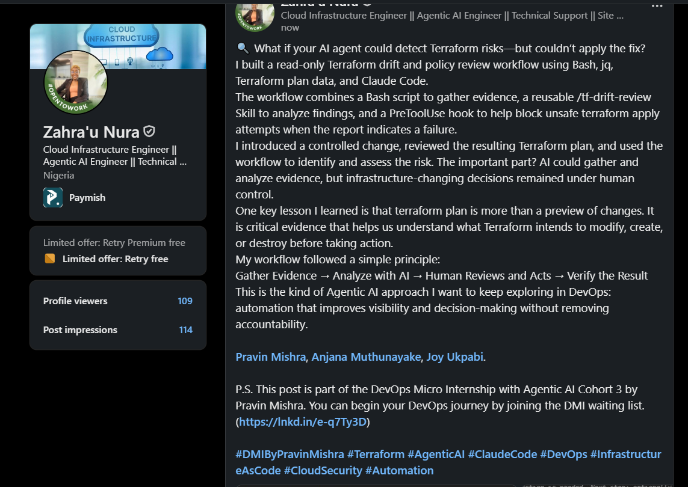

---

# Required Assignment Files

Confirm that the following files are included in your GitHub repository:

- `CLAUDE.md`
- `AI Assignment/tf-drift-check.sh`
- `.claude/skills/tf-drift-review/SKILL.md`
- `.claude/settings.json` containing the safety hook
- `reports/drift-detected-report.txt`
- `reports/resolved-report.txt`
- `drift-review-summary.md`

---

# Submission Instructions

- Complete Tasks 1–8 in sequence.
- Include Screenshots 1–19 exactly as specified.
- Answer every question under Tasks 1–8 in your own words.
- Complete all seven sections of the Terraform Drift Review Summary.
- Include the GitHub repository/folder URL containing the assignment files.
- Include your full name in the required reports and screenshots.
- Include the LinkedIn post URL and a screenshot of the published LinkedIn post.
- Do not expose access keys, passwords, tokens, account IDs, private keys, Terraform secrets, or other sensitive information.
- Review all screenshots carefully and hide or redact sensitive details where necessary.

---

# Completion Checklist

- [ ] Confirmed a clean Terraform baseline
- [ ] Created the required assignment workspace
- [ ] Created or updated `CLAUDE.md`
- [ ] Added project context and safety rules
- [ ] Created `tf-drift-check.sh`
- [ ] Added my full name to the report
- [ ] Validated the Bash script
- [ ] Made the script executable
- [ ] Used `terraform plan -detailed-exitcode`
- [ ] Used Terraform plan JSON
- [ ] Used `jq` to inspect destructive actions
- [ ] Used `jq` to inspect unsafe ingress
- [ ] Confirmed the baseline returns `HEALTHY`
- [ ] Created `/tf-drift-review`
- [ ] Restricted the Skill to appropriate tools
- [ ] Confirmed the Skill remains read-only
- [ ] Confirmed the Skill never runs `terraform apply`
- [ ] Confirmed the Skill never runs `terraform destroy`
- [ ] Introduced a controlled detectable difference
- [ ] Correctly identified whether it was true drift or a configuration change
- [ ] Saved `drift-detected-report.txt`
- [ ] Added the `PreToolUse` safety hook
- [ ] Verified the hook blocks `terraform apply` when the report is `FAIL`
- [ ] Reviewed the Terraform evidence before resolving the change
- [ ] Performed any infrastructure-changing action manually
- [ ] Ran the drift review again after resolution
- [ ] Confirmed the final status is `HEALTHY`
- [ ] Saved `resolved-report.txt`
- [ ] Completed `drift-review-summary.md`
- [ ] Mapped the workflow to `Gather --> Analyze --> Human Act --> Verify`
- [ ] Included all 19 numbered screenshots
- [ ] Answered all required questions
- [ ] Published the required LinkedIn post
- [ ] Added the LinkedIn post URL and screenshot
- [ ] Included the GitHub repository/folder URL
- [ ] Confirmed that no sensitive information is exposed

---

*This submission is part of the DevOps Micro Internship (DMI) Cohort 3 — Agentic AI Track.*
