# Assignment 03 — Deploy a Static Website to Multiple Servers Using a Multi-Play Ansible Playbook

Part of the DevOps Micro Internship (DMI) with Agentic AI

---

## Student Details

**Full Name:** Zahra'u Nura  
**Cloud Platform Used:** AWS / Azure  
**Server 1 URL:** `http://52.188.115.137`  
**Server 2 URL:** `http://52.188.10.55`

---

## Purpose

In this assignment, you will create a multi-play Ansible playbook to install Nginx, deploy a static website to two Ubuntu servers, and verify that the website is accessible from both servers.

You may use either AWS EC2 instances or Azure Virtual Machines as your managed servers.

---

# Task 1 — Create the Project Structure

## Goal

Create the required folders and files for the Ansible project.

## Evidence

### Screenshot 1 — Terminal or VS Code showing the complete `static-web` project structure

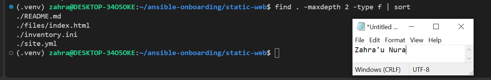

---

# Task 2 — Configure the Ansible Inventory

## Goal

Add both Ubuntu servers to the Ansible inventory.

## Evidence

### Screenshot 2 — Output of `ansible-inventory -i inventory.ini --graph` showing `web1` and `web2`

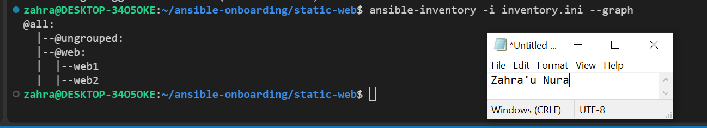

---

## Configuration File

Copy and paste the complete contents of your `inventory.ini` file below:

```ini
[web]
web1 ansible_host=52.188.115.137
web2 ansible_host=52.188.10.55

[web:vars]
ansible_user=azureuser
ansible_ssh_private_key_file=/home/zahra/.ssh/id_ed25519
ansible_python_interpreter=/usr/bin/python3.12
```

---

# Task 3 — Verify Ansible Connectivity

## Goal

Confirm that the Ansible controller can connect to both servers.

## Evidence

### Screenshot 3 — Ansible ping output showing `SUCCESS` and `pong` for both servers

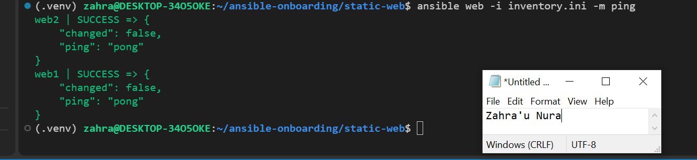

---

# Task 4 — Download and Personalize the Static Website

## Goal

Download `index.html` to the Ansible controller and personalize the website with your full name.

## Evidence

### Screenshot 4 — Edited `files/index.html` showing the footer line with your full name

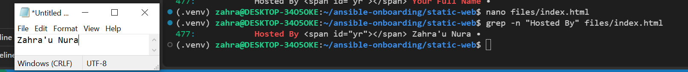

---

# Task 5 — Create the Multi-Play Ansible Playbook

## Goal

Create a single Ansible playbook containing separate plays for installation, deployment, and verification.

## Configuration File

Copy and paste the complete contents of your `site.yml` file below:

```yaml
---
# Play 1: Install and configure Nginx
- name: Install and configure Nginx
  hosts: web
  become: true

  tasks:
    - name: Update APT package cache
      ansible.builtin.apt:
        update_cache: true
        cache_valid_time: 3600

    - name: Install Nginx
      ansible.builtin.apt:
        name: nginx
        state: present

    - name: Start and enable Nginx
      ansible.builtin.service:
        name: nginx
        state: started
        enabled: true

# Play 2: Deploy the static website
- name: Deploy the static website
  hosts: web
  become: true

  tasks:
    - name: Copy the website to the Nginx document root
      ansible.builtin.copy:
        src: files/index.html
        dest: /var/www/html/index.html
        owner: www-data
        group: www-data
        mode: "0644"
      notify: Reload Nginx

  handlers:
    - name: Reload Nginx
      ansible.builtin.service:
        name: nginx
        state: reloaded

# Play 3: Verify both websites from the controller
- name: Verify website availability
  hosts: localhost
  connection: local
  gather_facts: false
  become: false

  tasks:
    - name: Check HTTP response from each web server
      ansible.builtin.uri:
        url: "http://{{ hostvars[item].ansible_host }}"
        method: GET
        status_code: 200
        return_content: false
      loop: "{{ groups['web'] }}"
      register: website_checks

    - name: Confirm each website returned HTTP 200
      ansible.builtin.assert:
        that:
          - item.status == 200
        success_msg: "{{ item.item }} returned HTTP {{ item.status }}"
        fail_msg: "{{ item.item }} failed HTTP verification"
      loop: "{{ website_checks.results }}"
      loop_control:
        label: "{{ item.item }}"

```

---

# Task 6 — Validate the Playbook Syntax

## Goal

Check the playbook for YAML or Ansible syntax errors before running it.

## Evidence

### Screenshot 5 — Successful syntax-check output showing `playbook: site.yml`

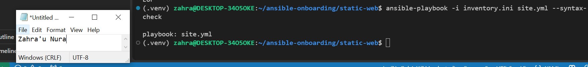

---

# Task 7 — Run the Multi-Play Playbook

## Goal

Install Nginx, deploy the website, and verify both servers in one playbook run.

## Evidence

### Screenshot 6 — Play 3 verification showing HTTP `200` for both servers

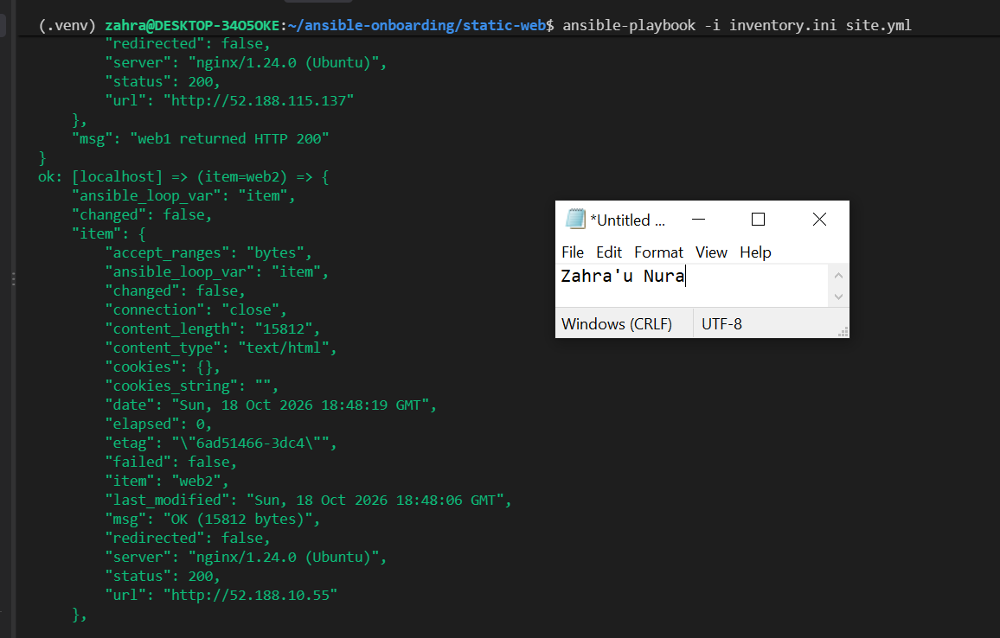

---

### Screenshot 7 — Final play recap showing `unreachable=0` and `failed=0` for `web1`, `web2`, and `localhost`

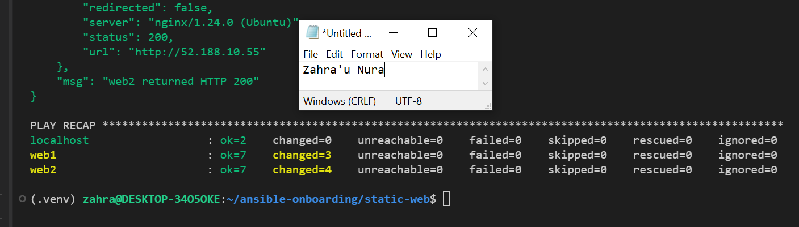

---

# Task 8 — Verify Idempotency

## Goal

Run the playbook again and confirm that it does not make unnecessary changes.

## Evidence

### Screenshot 8 — Second playbook run showing the play recap with `changed=0`, `unreachable=0`, and `failed=0` for both web servers

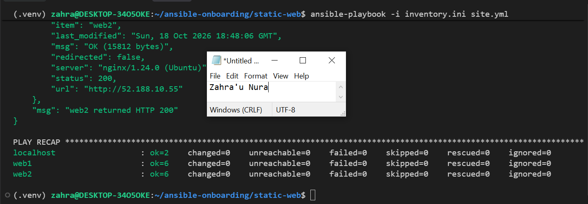

---

# Task 9 — Test Both Websites Manually

## Goal

Confirm that the static website is accessible from both public IP addresses.

## Evidence

### Screenshot 9 — `curl -I` output showing HTTP `200 OK` from both servers

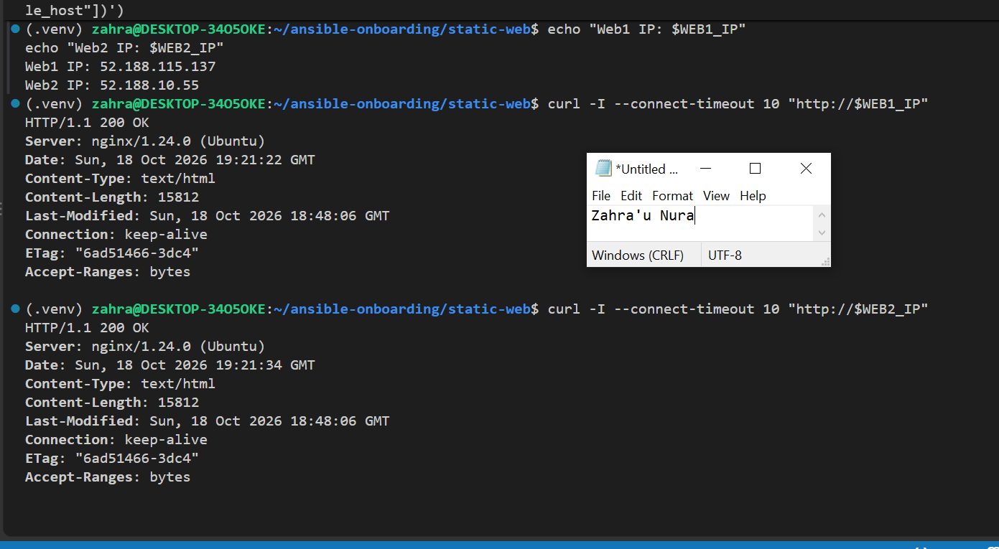

---

### Screenshot 10 — Browser showing the website from Server 1 with the public IP and your full name visible

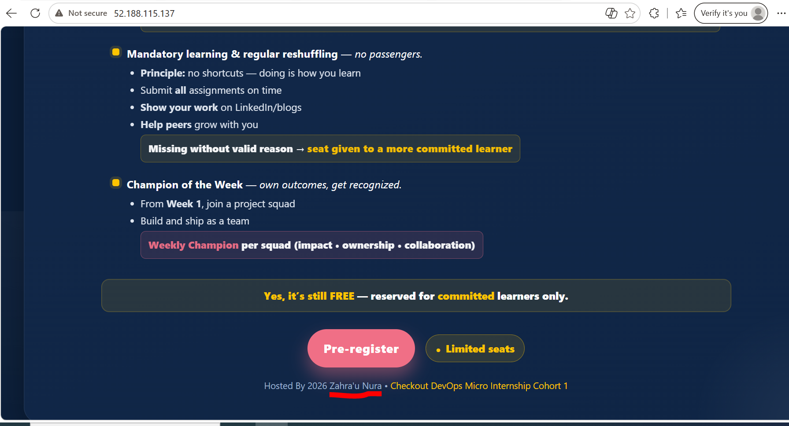

---

### Screenshot 11 — Browser showing the website from Server 2 with the public IP and your full name visible

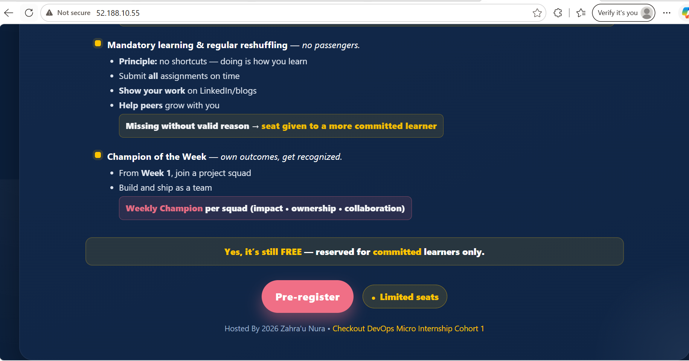

---

## Website URLs

Add both deployed website URLs below:

```text
Server 1: http://52.188.115.137
Server 2: http://52.188.10.55
``

---

# Task 10 — Complete the Project README

## Goal

Document how the project works and record what you learned.

## README Content

Copy and paste the complete contents of your `README.md` file below:

```markdown
# Multi-Play Ansible Static Website Deployment

**Completed By:** Zahra'u Nura

## Project Overview

This project demonstrates how to use a multi-play Ansible playbook to deploy a static website consistently across two Ubuntu Linux virtual machines hosted on Microsoft Azure.

The playbook automates Nginx installation, website deployment, service management, and HTTP verification. It uses three separate plays to organize these tasks and ensure the deployment is repeatable.

## Environment

- **Cloud Platform:** Microsoft Azure
- **Ansible Controller:** Ubuntu 26.04.1 LTS running on Windows Subsystem for Linux (WSL2)
- **Controller Python Version:** Python 3.14.4
- **Ansible Version:** Ansible Core 2.21.5
- **Number of Managed Servers:** 2
- **Managed Servers:** web1 and web2
- **Managed Server OS:** Ubuntu 24.04 LTS
- **Web Server:** Nginx
- **SSH Authentication:** ED25519 SSH key
- **Inventory File:** inventory.ini
- **Deployment Playbook:** site.yml

## How to Run the Playbook

First, activate the existing Python virtual environment and navigate to the project directory:

```bash
cd ~/ansible-onboarding
source .venv/bin/activate
cd static-web
```

Verify connectivity to both Azure web servers:

```bash
ansible web -i inventory.ini -m ping
```

Validate the playbook syntax:

```bash
ansible-playbook -i inventory.ini site.yml --syntax-check
```

Run the multi-play Ansible playbook:

```bash
ansible-playbook -i inventory.ini site.yml
```

The playbook performs three operations:

1. **Install and configure Nginx:** Updates the APT cache, installs Nginx, and ensures the service is running and enabled on both web servers.
2. **Deploy the static website:** Copies the personalized `index.html` file from the Ansible controller to both servers and reloads Nginx when the file changes.
3. **Verify website availability:** Sends HTTP requests from the Ansible controller and checks that both servers return HTTP status code 200.

## Issue Faced and Solution

One challenge I encountered was an SSH connection timeout while trying to connect to my Azure virtual machines.

After troubleshooting, I discovered that my router's public IP address had changed, and my WSL environment was also missing its default network route.

I restored the WSL default gateway, verified DNS and internet connectivity, and updated the Azure Network Security Group SSH source IP through Terraform.

This helped me understand the importance of correct networking, firewall rules, and SSH connectivity when managing cloud servers with Ansible.

## What I Learned

This assignment helped me understand how to create and execute multi-play Ansible playbooks for managing multiple servers.

I learned how to install packages, manage Linux services, deploy website files, configure handlers, and verify HTTP responses using Ansible modules.

I also learned how Ansible idempotency helps maintain consistent configurations without making unnecessary changes when the playbook is executed repeatedly.

## Why Installation and Deployment Are Separate

Separating installation and website deployment into different plays makes the automation easier to understand, maintain, troubleshoot, and reuse.

The installation play manages Nginx and its service configuration, while the deployment play manages the website content.

This separation allows website updates without repeatedly changing the Nginx installation.

## Benefit of the Ansible Copy Module

The Ansible `copy` module transfers the approved website file directly from the controller to both web servers.

This ensures both servers receive the same content without requiring Git to be installed or configured on each managed server.

It also supports idempotency by comparing file contents and updating the destination only when necessary.

## Conclusion

This project demonstrates how Ansible can automate consistent website deployments across multiple Azure Linux virtual machines.

Using inventory groups, separate plays, handlers, and HTTP verification makes the deployment easier to manage, repeat, and troubleshoot.
```

---

# LinkedIn Post Required

## Evidence

### LinkedIn Post URL

Paste your LinkedIn post URL here:

`https://www.linkedin.com/posts/zahra-u-nura_dmibypravinmishra-azure-ansible-ugcPost-7518024654456770561-nHad/?utm_source=share&utm_medium=member_desktop&rcm=ACoAABhheJ4Bw5LI3hMBUfCD5MZiGRXdKYKjr0U`

---

### Screenshot — Published LinkedIn post

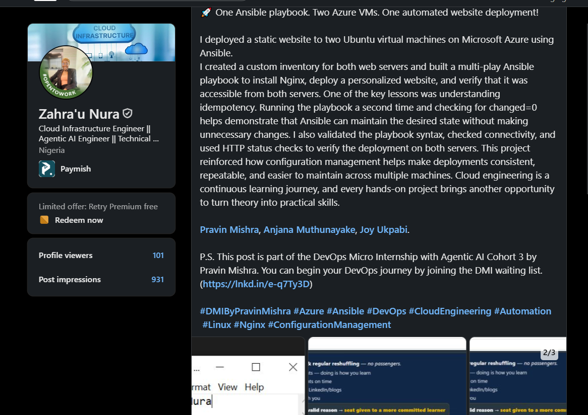

---

# Assignment Questions

Answer the following in your own words:

**1. What issue did you face while completing this assignment, and how did you fix it?**

I experienced SSH connection timeouts caused by a changed public IP and missing WSL default gateway. I restored the network route and updated the Azure NSG SSH rule through Terraform.

---

**2. What did you learn from this assignment?**

I learned how to use multi-play Ansible playbooks to install Nginx, deploy a static website to multiple Azure VMs, manage services, and verify website availability.

---

**3. Why is it useful to split installation, deployment, and verification into separate plays?**

It makes the automation easier to organize, troubleshoot, maintain, and reuse because each play handles a specific responsibility .

---

**4. What is one benefit of using the Ansible `copy` module instead of cloning the website directly from Git on every managed server?**

The copy module ensures both servers receive the same website files directly from the controller without requiring Git on each server.

---

**5. What does idempotency mean in this assignment?**

Idempotency means running the same playbook multiple times produces the same desired result without making unnecessary changes to the servers.

---

**6. What does the Ansible `uri` module verify in Play 3?**

The uri module sends HTTP requests to both web servers to verify that the websites are accessible and return HTTP status code 200.

---

# Required Files

Confirm that the following files are included in your assignment folder:

- [ ] `inventory.ini`
- [ ] `site.yml`
- [ ] `files/index.html`
- [ ] `README.md`

---

# Submission Instructions

- Add all required screenshots in the correct order.
- Full Name must be visible in required screenshots.
- Include both deployed website URLs.
- Paste `inventory.ini`, `site.yml`, and `README.md` as editable text.
- Answer all assignment questions clearly in your own words.
- Add your LinkedIn post URL.
- Do not expose SSH private keys, passwords, cloud account IDs, or other sensitive information.

---

# Completion Checklist

- [ ] Task 1: `static-web` folder structure is complete
- [ ] Task 2: Both servers are listed under the `[web]` group in `inventory.ini`
- [ ] Task 2: Inventory graph shows `web1` and `web2`
- [ ] Task 3: Ansible ping returns `SUCCESS` and `pong` for both servers
- [ ] Task 4: `files/index.html` contains your full name
- [ ] Task 5: `site.yml` contains three separate plays
- [ ] Task 5: Play 1 installs, starts, and enables Nginx
- [ ] Task 5: Play 2 deploys `index.html` using the `copy` module
- [ ] Task 5: Nginx reload handler is included
- [ ] Task 5: Play 3 verifies both web servers from the controller
- [ ] Task 6: Playbook syntax check passes
- [ ] Task 7: First playbook run completes with `unreachable=0` and `failed=0`
- [ ] Task 7: URI verification returns HTTP `200` for both servers
- [ ] Task 8: Second playbook run demonstrates idempotency
- [ ] Task 8: Second run shows `changed=0` for both web servers
- [ ] Task 9: Both `curl -I` commands return HTTP `200 OK`
- [ ] Task 9: Website loads from Server 1
- [ ] Task 9: Website loads from Server 2
- [ ] Task 9: Full name is visible on both deployed websites
- [ ] Task 10: `README.md` contains all required explanations
- [ ] Screenshots 1–11 are included
- [ ] `inventory.ini`, `site.yml`, and `README.md` are pasted as editable text
- [ ] Both website URLs are included
- [ ] Assignment questions are answered
- [ ] LinkedIn post published
- [ ] LinkedIn post URL added
- [ ] No sensitive information is exposed

---

## About DMI & CloudAdvisory

DevOps Micro Internship (DMI) is a project-based DevOps program run by Pravin Mishra and The CloudAdvisory, focused on real-world execution, systems thinking, and career readiness.

It helps learners build strong DevOps foundations with hands-on experience.

---

## Resources

- DMI Official Website: [https://dmi.pravinmishra.com?utm_source=github&utm_medium=readme](https://dmi.pravinmishra.com?utm_source=github&utm_medium=readme)
- University: [https://university.pravinmishra.com?utm_source=github&utm_medium=readme](https://university.pravinmishra.com?utm_source=github&utm_medium=readme)
- Discord Community: [https://discord.pravinmishra.com?utm_source=github&utm_medium=readme](https://discord.pravinmishra.com?utm_source=github&utm_medium=readme)
- Blog: [https://dmi.pravinmishra.com/blog?utm_source=github&utm_medium=readme](https://dmi.pravinmishra.com/blog?utm_source=github&utm_medium=readme)
- YouTube Playlist: [https://www.youtube.com/playlist?list=PLFeSNDtI4Cho](https://www.youtube.com/playlist?list=PLFeSNDtI4Cho)
- Pravin Mishra LinkedIn: [https://www.linkedin.com/in/pravin-mishra-aws-trainer/](https://www.linkedin.com/in/pravin-mishra-aws-trainer/)
- CloudAdvisory LinkedIn: [https://www.linkedin.com/company/thecloudadvisory/](https://www.linkedin.com/company/thecloudadvisory/)

---

*This submission is part of DevOps Micro Internship (DMI) — Agentic AI Track.*