# Assignment 04 — Deploy Mini Finance on Azure Using Terraform and Ansible

Part of the DevOps Micro Internship (DMI) with Agentic AI

---

## Purpose

In this assignment, you will provision Azure infrastructure using Terraform and deploy the Mini Finance website using an Ansible multi-play playbook.

Terraform will create the Azure Virtual Machine and networking resources. Ansible will install Nginx, clone the Mini Finance repository, deploy the website, and verify the deployment.

---

# Task 1 — Create the Project Structure

## Goal

Create separate directories and files for the Terraform infrastructure and Ansible configuration.

### Evidence

#### Screenshot 1 — Terminal or VS Code showing the complete `mini-finance` project structure

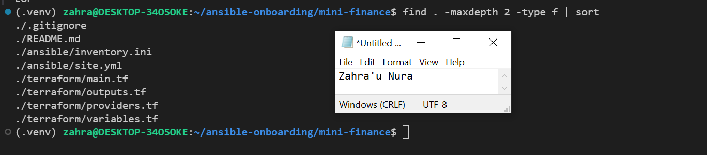

---

### Notes

Created the mini-finance project directory with separate Terraform and Ansible folders. Added the required configuration files, README, and .gitignore to organize the project and protect sensitive files.

---

# Task 2 — Create the Azure Infrastructure Using Terraform

## Goal

Use Terraform to provision an Ubuntu Virtual Machine with the required Azure networking and security resources.

### Evidence

#### Screenshot 2 — Terraform code showing the `Allow-SSH` rule for port `22` and the `Allow-HTTP` rule for port `80`

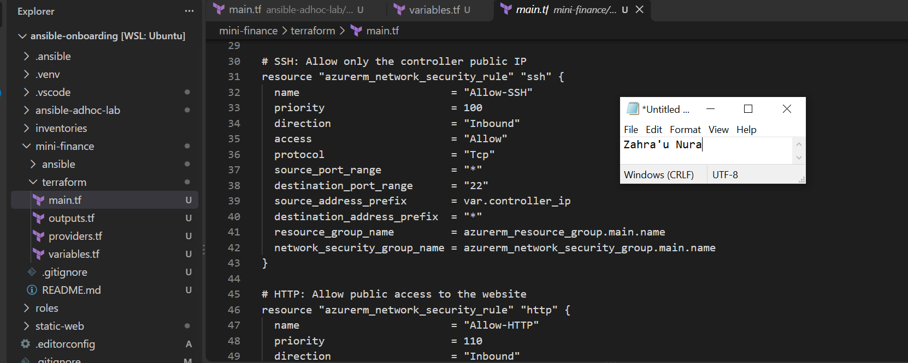

---

#### Screenshot 3 — Terraform code showing the association between `nsg-mini-finance` and `nic-mini-finance`

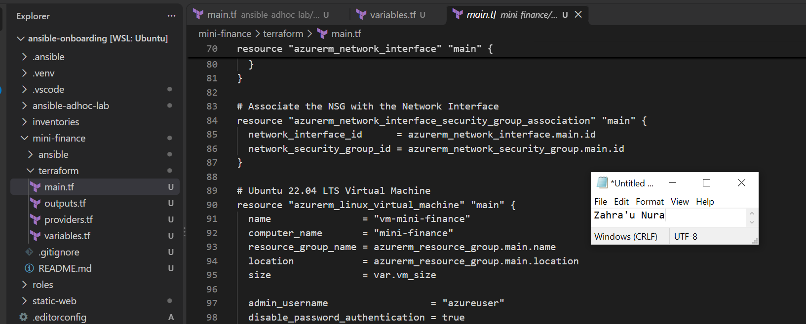

---

### Notes

Wrote Terraform configurations to provision an Ubuntu 22.04 VM, resource group, virtual network, subnet, public IP, network interface, and Network Security Group. Configured SSH access on port 22 from my public IP and HTTP access on port 80.

---

# Task 3 — Initialize and Apply the Terraform Configuration

## Goal

Format and validate the Terraform configuration, review the execution plan, and provision the Azure infrastructure.

### Evidence

#### Screenshot 4 — End of the `terraform apply` output showing `Apply complete!` with no errors

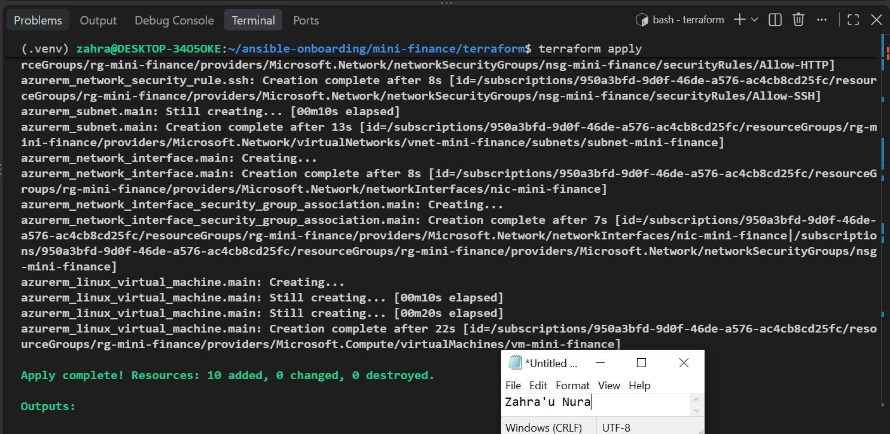

---

#### Screenshot 5 — Output of `terraform output public_ip` showing the VM’s public IP address

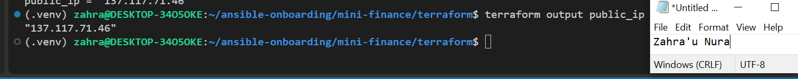

---

### Notes

Initialized Terraform, formatted and validated the configuration, reviewed the execution plan, and deployed the Azure infrastructure. Retrieved the VM's public IP using Terraform outputs.

---

# Task 4 — Verify Passwordless SSH Access

## Goal

Confirm that the Ansible controller can connect to the Terraform-provisioned Azure VM using SSH key authentication.

### Evidence

#### Screenshot 6 — Passwordless SSH command and the returned `mini-finance` hostname

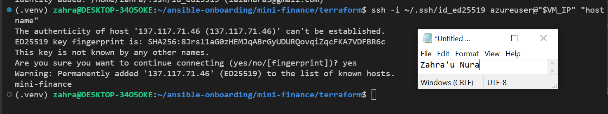

---

### Notes

Tested SSH connectivity from my Ubuntu WSL controller to the Azure VM using an ED25519 SSH key. Verified the expected hostname, mini-finance, without requiring the Azure user's password.

---

# Task 5 — Create the Ansible Inventory and Verify Connectivity

## Goal

Add the Terraform-provisioned Azure VM to the Ansible inventory and confirm that Ansible can connect to it.

### Evidence

#### Screenshot 7 — Ansible ping output showing `SUCCESS` and `pong` from the Azure VM

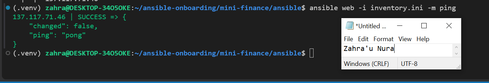

---

### Configuration File

Copy and paste the complete contents of your `ansible/inventory.ini` file below:

```ini
[web]
137.117.71.46

[web:vars]
ansible_user=azureuser
ansible_ssh_private_key_file=/home/zahra/.ssh/id_ed25519
ansible_python_interpreter=/usr/bin/python3

```

---

# Task 6 — Create the Multi-Play Ansible Playbook

## Goal

Create one Ansible playbook containing separate plays to install Nginx, deploy the Mini Finance website, and verify the deployment.

### Evidence

#### Screenshot 8 — `site.yml` showing Play 1 and the beginning of Play 2

Screenshot must show:

- Play 1 targeting the `web` group
- Installation of `nginx`, `git`, and `rsync`
- Nginx service configured as started and enabled
- Beginning of Play 2 with the Git repository URL and synchronization task

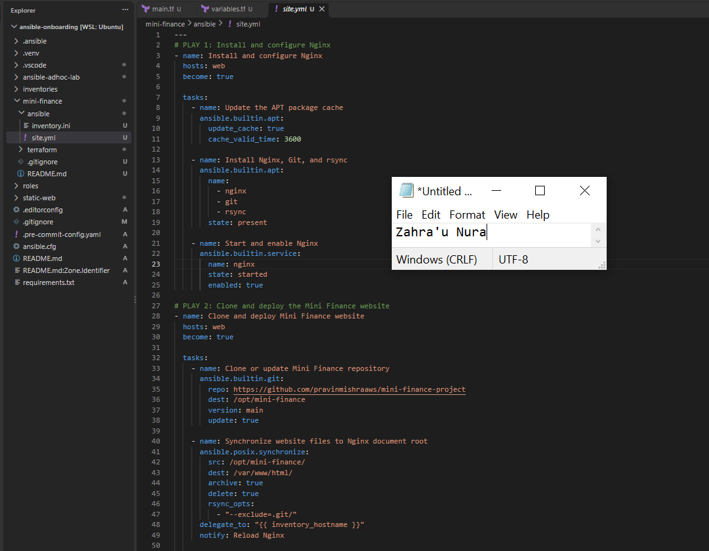

---

#### Screenshot 9 — `site.yml` showing the deployment destination, handler, and Play 3 verification

Screenshot must show:

- Website destination `/var/www/html/`
- Ownership set to `www-data:www-data`
- Nginx reload handler
- Play 3 targeting `localhost`
- The `uri` verification and `assert` condition

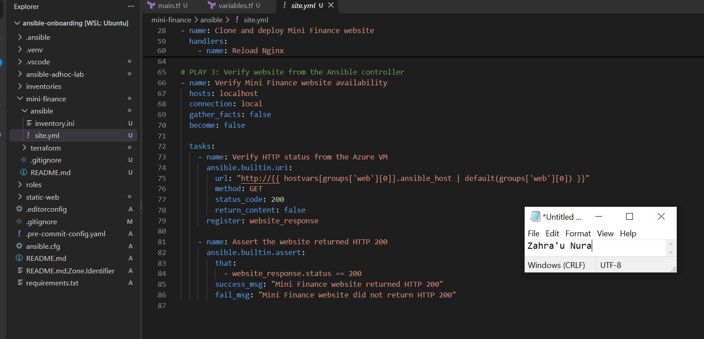

---

### Configuration File

Copy and paste the complete contents of your `ansible/site.yml` file below:

```yaml
---
# PLAY 1: Install and configure Nginx
- name: Install and configure Nginx
  hosts: web
  become: true

  tasks:
    - name: Update the APT package cache
      ansible.builtin.apt:
        update_cache: true
        cache_valid_time: 3600

    - name: Install Nginx, Git, and rsync
      ansible.builtin.apt:
        name:
          - nginx
          - git
          - rsync
        state: present

    - name: Start and enable Nginx
      ansible.builtin.service:
        name: nginx
        state: started
        enabled: true

# PLAY 2: Clone and deploy the Mini Finance website
- name: Clone and deploy Mini Finance website
  hosts: web
  become: true

  tasks:
    - name: Clone or update Mini Finance repository
      ansible.builtin.git:
        repo: https://github.com/pravinmishraaws/mini_finance.git
        dest: /opt/mini-finance
        version: main
        update: true

    - name: Synchronize website files to Nginx document root
      ansible.posix.synchronize:
        src: /opt/mini-finance/
        dest: /var/www/html/
        archive: true
        delete: true
        rsync_opts:
          - "--exclude=.git/"
      delegate_to: "{{ inventory_hostname }}"
      notify: Reload Nginx

    - name: Set website file ownership
      ansible.builtin.file:
        path: /var/www/html/
        owner: www-data
        group: www-data
        recurse: true
        state: directory

  handlers:
    - name: Reload Nginx
      ansible.builtin.service:
        name: nginx
        state: reloaded

# PLAY 3: Verify website from the Ansible controller
- name: Verify Mini Finance website availability
  hosts: localhost
  connection: local
  gather_facts: false
  become: false

  tasks:
    - name: Verify HTTP status from the Azure VM
      ansible.builtin.uri:
        url: "http://{{ hostvars[groups['web'][0]].ansible_host | default(groups['web'][0]) }}"
        method: GET
        status_code: 200
        return_content: false
      register: website_response

    - name: Assert the website returned HTTP 200
      ansible.builtin.assert:
        that:
          - website_response.status == 200
        success_msg: "Mini Finance website returned HTTP 200"
        fail_msg: "Mini Finance website did not return HTTP 200"

```

---

# Task 7 — Validate and Run the Ansible Playbook

## Goal

Validate the syntax of the multi-play Ansible playbook and run it to install Nginx, deploy the Mini Finance website, and verify the deployment.

### Evidence

#### Screenshot 10 — Successful playbook syntax check showing `playbook: site.yml`

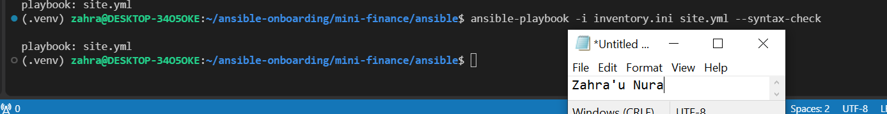

---

#### Screenshot 11 — Play 3 output showing the successful HTTP verification and assertion

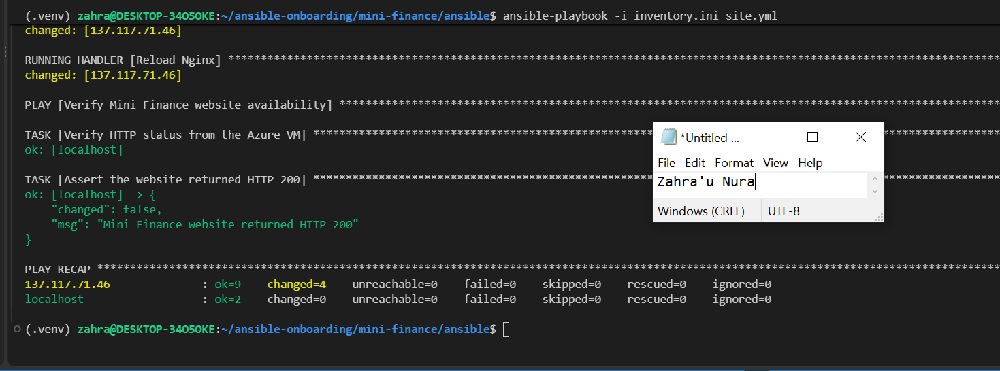

---

#### Screenshot 12 — Final `PLAY RECAP` showing `failed=0` and `unreachable=0`

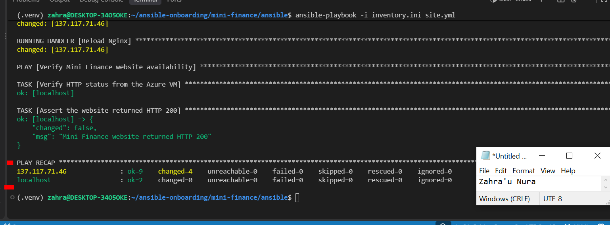

---

### Notes

Validated the playbook syntax and ran the deployment. Encountered an issue because the GitHub repository URL provided in the assignment was incorrect. Identified the correct repository, https://github.com/pravinmishraaws/mini_finance, and updated the playbook before retrying the deployment.

---

# Task 8 — Test the Mini Finance Website in a Browser

## Goal

Confirm that the Mini Finance website is publicly accessible through the Azure VM’s public IP address.

### Evidence

#### Screenshot 13 — Mini Finance website successfully loading in the browser, with the Azure VM’s public IP address visible in the address bar

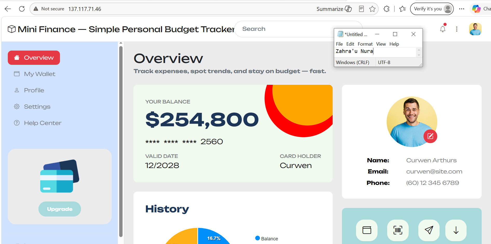

---

### Website URL

Add your deployed website URL below:

```text
http://137.117.71.46/
```

---

# Task 9 — Create the Project README

## Goal

Create a `README.md` file to document the Mini Finance infrastructure and deployment project.

### Evidence

#### Screenshot 14 — Completed `README.md` displayed in the VS Code Markdown preview or terminal

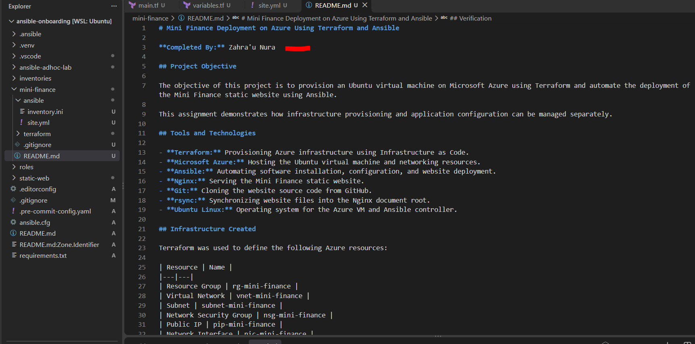

---

### README Content

Copy and paste the complete contents of your `README.md` file below:

```markdown
# Mini Finance Deployment on Azure Using Terraform and Ansible

**Completed By:** Zahra'u Nura

## Project Objective

The objective of this project is to provision an Ubuntu virtual machine on Microsoft Azure using Terraform and automate the deployment of the Mini Finance static website using Ansible.

This assignment demonstrates how infrastructure provisioning and application configuration can be managed separately.

## Tools and Technologies

- **Terraform:** Provisioning Azure infrastructure using Infrastructure as Code.
- **Microsoft Azure:** Hosting the Ubuntu virtual machine and networking resources.
- **Ansible:** Automating software installation, configuration, and website deployment.
- **Nginx:** Serving the Mini Finance static website.
- **Git:** Cloning the website source code from GitHub.
- **rsync:** Synchronizing website files into the Nginx document root.
- **Ubuntu Linux:** Operating system for the Azure VM and Ansible controller.

## Infrastructure Created

Terraform was used to define the following Azure resources:

| Resource | Name |
|---|---|
| Resource Group | rg-mini-finance |
| Virtual Network | vnet-mini-finance |
| Subnet | subnet-mini-finance |
| Network Security Group | nsg-mini-finance |
| Public IP | pip-mini-finance |
| Network Interface | nic-mini-finance |
| Ubuntu Virtual Machine | vm-mini-finance |

The virtual machine runs Ubuntu 22.04 LTS.

The Network Security Group allows SSH access on port 22 from the controller's public IP address and HTTP access on port 80 for website visitors.

## Ansible Deployment Workflow

The Ansible playbook contains three plays:

**Play 1 — Install and Configure Nginx**

Installs Nginx, Git, and rsync on the Azure VM and ensures Nginx is started and enabled.

**Play 2 — Deploy Mini Finance Website**

Clones the Mini Finance website from:

https://github.com/pravinmishraaws/mini_finance

The playbook uses the Ansible synchronize module to copy website files from `/opt/mini-finance/` to `/var/www/html/`, sets ownership to `www-data`, and reloads Nginx when files change.

**Play 3 — Verify Deployment**

Uses the Ansible `uri` module to send an HTTP request to the VM's public IP address and the `assert` module to confirm that the response status is 200.

## Verification

The deployment can be verified using the following commands:

```bash
terraform output public_ip
```

```bash
ansible web -i inventory.ini -m ping
```

```bash
ansible-playbook -i inventory.ini site.yml
```

```bash
curl -I http://137.117.71.46
```

The Mini Finance website can also be verified in a browser using the Azure VM's public IP address.

## Challenge and Solution

One challenge I encountered was that the GitHub repository URL supplied in the assignment returned a 404 error, which prevented the website cloning task from completing.

I identified the correct repository URL, updated the `repo` value in the Ansible playbook, and reran the deployment.

The correct repository is:

https://github.com/pravinmishraaws/mini_finance

This taught me the importance of checking repository URLs and troubleshooting individual automation tasks.

## What I Learned

This assignment helped me understand how Terraform and Ansible work together in a DevOps deployment.

Terraform manages the Azure infrastructure, including networking, security rules, and virtual machines, while Ansible manages software installation and application deployment.

I also learned how Git, rsync, Nginx handlers, and HTTP verification can be combined to create a repeatable deployment workflow.

## Conclusion

This project demonstrates how Infrastructure as Code and configuration management can simplify deploying a web application to Microsoft Azure.

Separating infrastructure provisioning from server configuration makes deployments easier to maintain, troubleshoot, and reproduce.
```

---

# LinkedIn Post Required

## Evidence

#### Screenshot 15 — Published LinkedIn post showing the text and at least one deployment screenshot

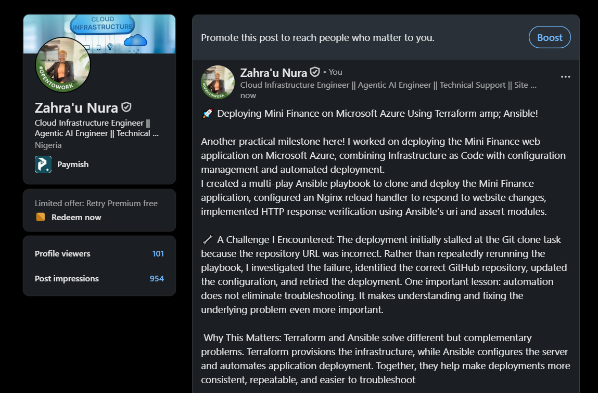

---

#### LinkedIn Post URL

Paste your LinkedIn post URL here:

`https://www.linkedin.com/posts/zahra-u-nura_dmibypravinmishra-devops-terraform-share-7518027408244060160-l6LP/?utm_source=share&utm_medium=member_desktop&rcm=ACoAABhheJ4Bw5LI3hMBUfCD5MZiGRXdKYKjr0U`

---

### LinkedIn Submission Notes

**One challenge you faced and how you fixed it:**

During deployment, the Ansible playbook stalled because the GitHub repository URL provided in the assignment was incorrect. I investigated the issue, found the correct repository URL, updated the Ansible playbook, and retried the deployment.

---

**One real-world example where you can use this learning:**

A company can use Terraform and Ansible to automate the deployment of web applications across development, staging, and production environments. Terraform provisions Azure infrastructure, while Ansible installs required software, deploys applications, and verifies their availability. This reduces manual work and improves deployment consistency.

---

# Assignment Questions

Answer the following in your own words:

**1. What did you provision using Terraform in this assignment?**

I used Terraform to provision an Ubuntu 22.04 VM on Azure, including a resource group, virtual network, subnet, public IP, network interface, and security group.

---

**2. What did Ansible configure and deploy in this assignment?**

Ansible installed Nginx, Git, and rsync, configured the web server, and deployed the Mini Finance website from GitHub.

---

**3. Why is SSH access on port `22` restricted to your public IP address?**

To improve security by allowing SSH connections only from my trusted public IP and preventing unauthorized access.

---

**4. Why is HTTP port `80` open to the internet?**

To allow users to access the Mini Finance website publicly through their web browsers.

---

**5. What is the purpose of the Ansible inventory file?**

It identifies the managed servers and provides connection details such as their IP addresses, SSH usernames, and private key paths.

---

**6. Why does the playbook use separate plays for install, deploy, and verify?**

To organize the automation into separate tasks, making it easier to maintain, troubleshoot, and reuse.

---

**7. Why is `rsync` useful when deploying website files?**

Rsync efficiently synchronizes website files and transfers only changed data, reducing unnecessary transfers.

---

**8. What does the Ansible `uri` module verify in this assignment?**

It checks whether the Mini Finance website is accessible and returns HTTP status code 200.

---

**9. What issue did you face during this assignment, and how did you fix it?**

The GitHub repository URL provided was incorrect, causing the Ansible clone task to stall. I found the correct URL, updated the playbook, and retried the deployment.

---

**10. What did you learn from using Terraform and Ansible together?**

I learned how Terraform automates cloud infrastructure provisioning while Ansible handles server configuration and application deployment, making the process more consistent and repeatable.

---

# Required Files

Confirm that the following files are included in your assignment folder:

- [ ] `.gitignore`
- [ ] `README.md`
- [ ] `terraform/providers.tf`
- [ ] `terraform/main.tf`
- [ ] `terraform/variables.tf`
- [ ] `terraform/outputs.tf`
- [ ] `ansible/inventory.ini`
- [ ] `ansible/site.yml`

---

# Submission Instructions

- Add all required screenshots in the correct order.
- Full Name must be visible in required screenshots.
- Add the Azure VM public IP address.
- Add the final Mini Finance website URL.
- Paste `inventory.ini`, `site.yml`, and `README.md` as editable text.
- Answer all assignment questions clearly in your own words.
- Add your LinkedIn post URL.
- Do not expose SSH private keys, passwords, Azure credentials, subscription IDs, Terraform state contents, or other sensitive information.

---

# Completion Checklist

- [ ] Task 1: `mini-finance` project structure created
- [ ] Task 1: `.gitignore` created
- [ ] Task 2: Terraform Azure infrastructure code created
- [ ] Task 2: `Allow-SSH` rule configured for port `22`
- [ ] Task 2: `Allow-HTTP` rule configured for port `80`
- [ ] Task 2: NSG associated with the Network Interface
- [ ] Task 3: `terraform fmt` completed
- [ ] Task 3: `terraform init` completed
- [ ] Task 3: `terraform validate` completed successfully
- [ ] Task 3: `terraform apply` completed successfully
- [ ] Task 3: `terraform output public_ip` displayed the VM public IP
- [ ] Task 4: Passwordless SSH works from the Ansible controller
- [ ] Task 5: `inventory.ini` created
- [ ] Task 5: Ansible ping returns `SUCCESS` and `pong`
- [ ] Task 6: `site.yml` contains three separate plays
- [ ] Task 6: Play 1 installs Nginx, Git, and rsync
- [ ] Task 6: Play 2 clones and deploys the Mini Finance website
- [ ] Task 6: Play 3 verifies HTTP status code `200`
- [ ] Task 7: Playbook syntax check passes
- [ ] Task 7: Ansible playbook completes successfully
- [ ] Task 7: Final recap shows `failed=0` and `unreachable=0`
- [ ] Task 8: Mini Finance website loads in the browser
- [ ] Task 8: Azure VM public IP is visible in the browser screenshot
- [ ] Task 9: `README.md` completed
- [ ] Screenshots 1–15 are included
- [ ] `inventory.ini`, `site.yml`, and `README.md` are pasted as editable text
- [ ] Assignment questions are answered
- [ ] LinkedIn post published with Anyone visibility
- [ ] LinkedIn post URL added
- [ ] No sensitive information is exposed

---

## About DMI & CloudAdvisory

DevOps Micro Internship (DMI) is a project-based DevOps program run by Pravin Mishra and The CloudAdvisory, focused on real-world execution, systems thinking, and career readiness.

It helps learners build strong DevOps foundations with hands-on experience.

---

## Resources

- DMI Official Website: [https://dmi.pravinmishra.com?utm_source=github&utm_medium=readme](https://dmi.pravinmishra.com?utm_source=github&utm_medium=readme)
- University: [https://university.pravinmishra.com?utm_source=github&utm_medium=readme](https://university.pravinmishra.com?utm_source=github&utm_medium=readme)
- Discord Community: [https://discord.pravinmishra.com?utm_source=github&utm_medium=readme](https://discord.pravinmishra.com?utm_source=github&utm_medium=readme)
- Blog: [https://dmi.pravinmishra.com/blog?utm_source=github&utm_medium=readme](https://dmi.pravinmishra.com/blog?utm_source=github&utm_medium=readme)
- YouTube Playlist: [https://www.youtube.com/playlist?list=PLFeSNDtI4Cho](https://www.youtube.com/playlist?list=PLFeSNDtI4Cho)
- Pravin Mishra LinkedIn: [https://www.linkedin.com/in/pravin-mishra-aws-trainer/](https://www.linkedin.com/in/pravin-mishra-aws-trainer/)
- CloudAdvisory LinkedIn: [https://www.linkedin.com/company/thecloudadvisory/](https://www.linkedin.com/company/thecloudadvisory/)

---

*This submission is part of DevOps Micro Internship (DMI) — Agentic AI Track.*