# Assignment — Deploy EpicBook with Terraform and Ansible Roles

Part of the DevOps Micro Internship (DMI) with Agentic AI

---

## Purpose

In this assignment, you will deploy the EpicBook web application using Terraform and Ansible roles.

Terraform provisions the cloud infrastructure, including one Ubuntu VM and one managed MySQL database. Ansible roles configure the VM, install required software, deploy the EpicBook application, configure Nginx, connect the app to the managed MySQL database, and verify the deployment.

---

# Task 1 — Set Up the Project Folder Layout

## Goal

Create the project folder structure for Terraform and Ansible roles.

Terraform will be used to provision the cloud infrastructure. Ansible roles will be used to configure the VM and deploy the EpicBook application.

### Evidence

#### Screenshot 1 — Terminal showing the completed `epicbook-prod` project structure

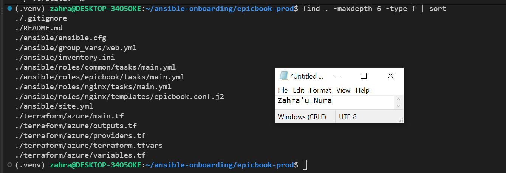

---

### Notes

Answer the following in your own words:

**1. Which cloud provider did you choose for this assignment?**

I chose Microsoft Azure, using the West US 2 region.

---

**2. Why is it useful to keep Terraform files and Ansible files in separate folders?**

It separates infrastructure provisioning from server configuration, making the project easier to manage and troubleshoot.

---

**3. What is the purpose of the `roles` directory in Ansible?**

It organizes automation into reusable components, with each role handling a specific responsibility.

---

# Task 2 — Provision the Infrastructure with Terraform

## Goal

Run Terraform to provision the cloud infrastructure for the EpicBook deployment.

Terraform will create the VM, managed MySQL database, networking, security rules, and required outputs.

### Evidence

#### Screenshot 2 — `terraform apply` completed successfully

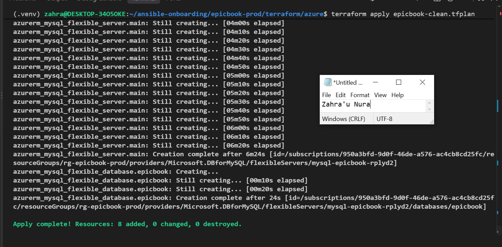

---

#### Screenshot 3 — Output of `terraform output`

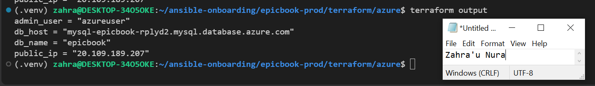

---

#### Screenshot 4 — Azure Portal or AWS Console showing the VM running

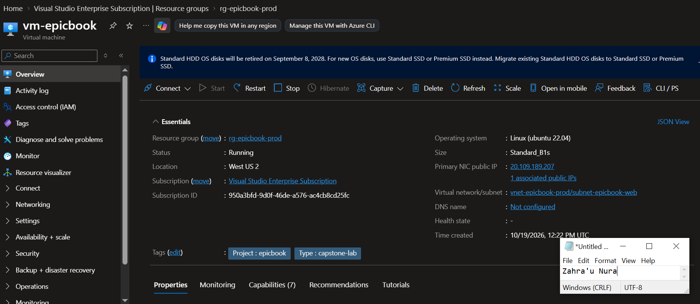

---

#### Screenshot 5 — Azure Portal or AWS Console showing the managed MySQL database created

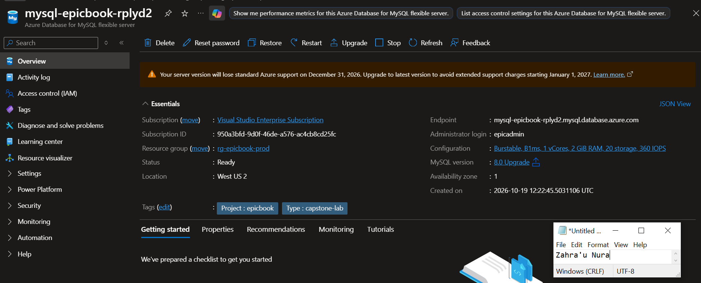

---

### Notes

Answer the following in your own words:

**1. What resources did Terraform create for this assignment?**

Terraform was configured to create an Ubuntu VM, Azure MySQL Flexible Server, resource group, virtual network, subnets, security rules, public IP, network interface, and private DNS resources.

---

**2. Why should you review `terraform plan` before running `terraform apply`?**

To understand the proposed changes and prevent accidental deletion, replacement, or misconfiguration of resources.

---

**3. Why should database passwords not be shown in Terraform output?**

To prevent unauthorized access and protect sensitive database credentials.

---

# Task 3 — Verify SSH Key-Based Access

## Goal

Verify that the cloud VM can be accessed from the Ansible controller using SSH key-based authentication.

### Evidence

#### Screenshot 6 — Successful SSH hostname check from the Ansible controller

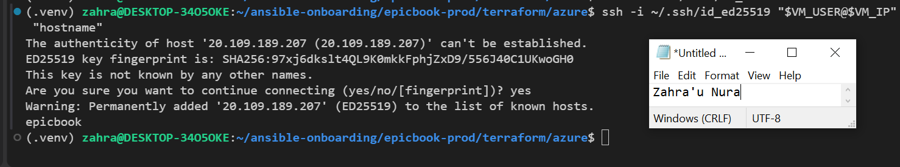

---

### Notes

Answer the following in your own words:

**1. What command did you use to verify SSH access?**

ssh -i ~/.ssh/id_ed25519 azureuser@20.109.189.207 "hostname".

---

**2. What proves that SSH key-based access worked successfully?**

The SSH command returns the VM hostname, epicbook, without requesting the remote user's password.

---

**3. What would you check if SSH returned `Permission denied (publickey)`?**

I would check the SSH username, private key path, file permissions, and whether the matching public key was configured on the VM.

---

# Task 4 — Create the Ansible Inventory and Configuration

## Goal

Create the Ansible inventory file and local Ansible configuration for the EpicBook VM.

The inventory tells Ansible which VM to manage and which SSH user to use.

### Evidence

#### Screenshot 7 — `inventory.ini` showing the VM under the `web` group

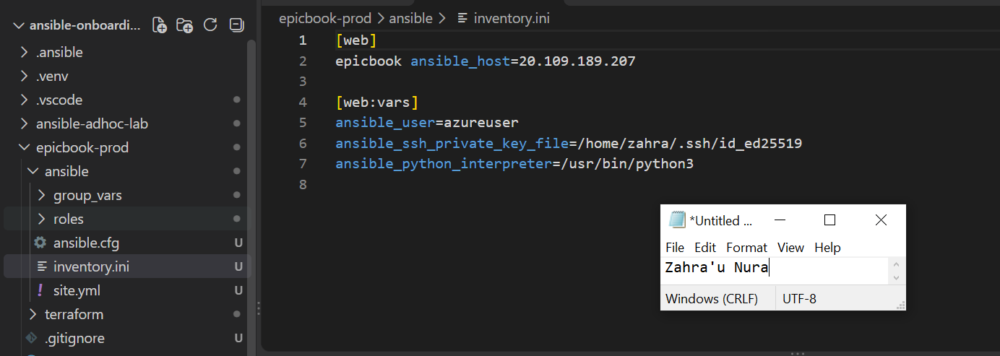

---

#### Screenshot 8 — Output of `ansible-inventory -i inventory.ini --graph`

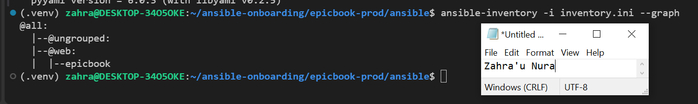

---

#### Screenshot 9 — Output of `ansible web -i inventory.ini -m ping`

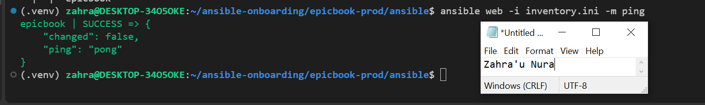

---

### Notes

Answer the following in your own words:

**1. What is the purpose of `inventory.ini`?**

It identifies the servers Ansible manages and provides their connection details.

---

**2. What does `ansible_host` store?**

It stores the public IP address or hostname of the managed server.

---

**3. What does `ansible_ssh_private_key_file` tell Ansible?**

It specifies which SSH private key to use when connecting to the server.

---

**4. Why is `host_key_checking = False` used only for this temporary lab?**

It avoids SSH fingerprint prompts during testing, but production systems should verify host identities to prevent impersonation attacks.

---

# Task 5 — Create the Main Ansible Playbook

## Goal

Create the main Ansible playbook that runs the required roles in the correct order.

The `site.yml` file will call the `common`, `nginx`, and `epicbook` roles.

### Evidence

#### Screenshot 10 — `site.yml` showing the roles in the correct order

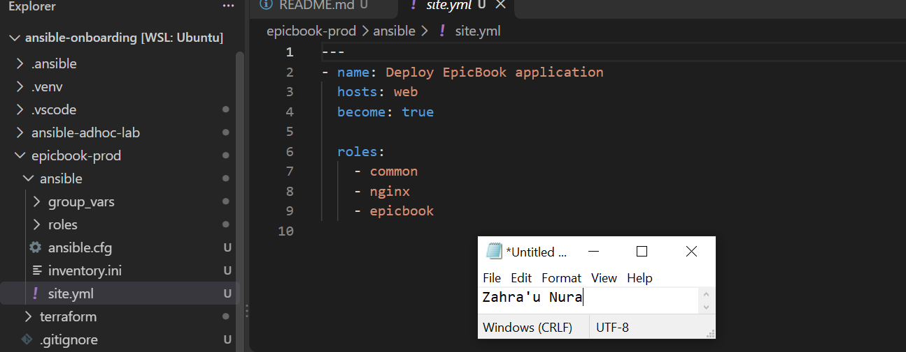

---

#### Screenshot 11 — Output of `ansible-playbook -i inventory.ini site.yml --syntax-check`

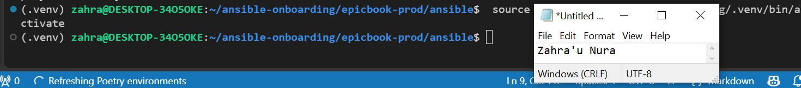

---

### Notes

Answer the following in your own words:

**1. What is the purpose of `site.yml`?**

It is the main Ansible playbook that executes the common, nginx, and epicbook roles.

---

**2. Why should the roles run in the order `common`, `nginx`, and `epicbook`?**

The server must first be prepared, then Nginx configured, before deploying and starting the application.

---

**3. What does `become: true` allow Ansible to do?**

It allows Ansible to execute tasks with elevated privileges, usually as root.

---

# Task 6 — Create the `common` Role

## Goal

Create the `common` role to prepare the Ubuntu VM with the basic packages required for the EpicBook deployment.

This role handles the common server setup before Nginx and the application are configured.

### Evidence

#### Screenshot 12 — `roles/common/tasks/main.yml` showing the common setup tasks

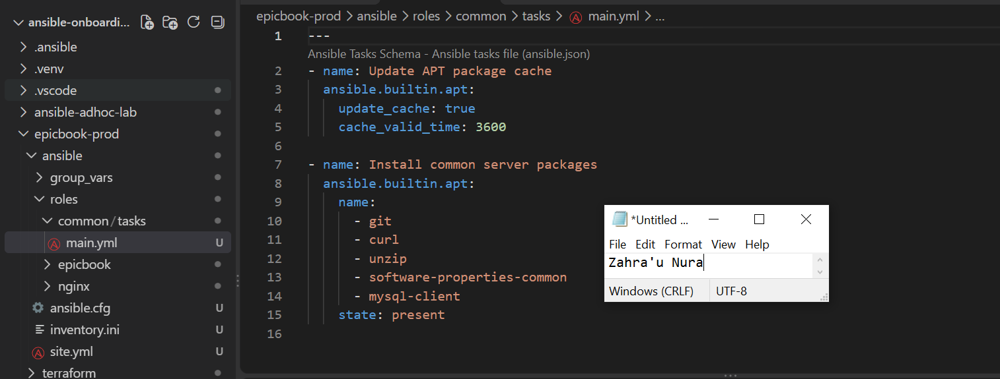

---

### Notes

Answer the following in your own words:

**1. What is the responsibility of the `common` role?**

It prepares the Ubuntu server by updating packages and installing essential tools such as Git, curl, unzip, and MySQL client.

---

**2. Why should Nginx installation not be placed inside the `common` role?**

Keeping Nginx in its own role improves separation of responsibilities and makes the automation more reusable.

---

**3. Why is `mysql-client` useful in this deployment?**

It allows the VM to connect to the managed MySQL database, execute queries, and import SQL files.

---

# Task 7 — Create the `nginx` Role

## Goal

Create the `nginx` role to install Nginx and configure it as a reverse proxy for the EpicBook application.

Nginx will receive browser traffic on port `80` and forward it to the EpicBook Node.js application running on the VM.

### Evidence

#### Screenshot 13 — `roles/nginx/tasks/main.yml` showing Nginx installation and site configuration tasks

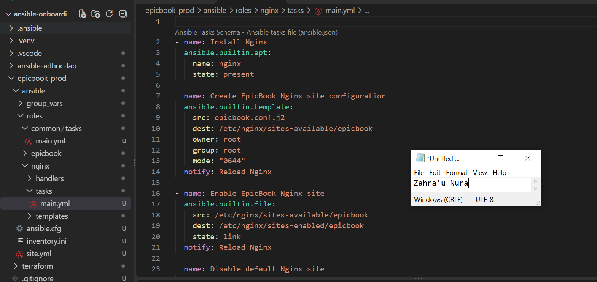

---

#### Screenshot 14 — `roles/nginx/templates/epicbook.conf.j2` showing the reverse proxy configuration

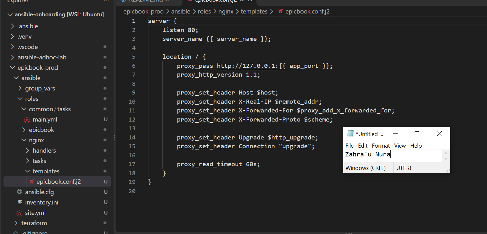

---

### Notes

Answer the following in your own words:

**1. What is the responsibility of the `nginx` role?**

It installs Nginx, configures the reverse proxy, enables the website, and manages the Nginx service.

---

**2. Why is Nginx configured as a reverse proxy in this deployment?**

Nginx receives public HTTP requests on port 80 and forwards them to the Node.js application on port 8080.

---

**3. Why should the application port come from `group_vars/web.yml` instead of being hard-coded?**

It makes the configuration flexible and allows the application port to be changed without editing the role.

---

# Task 8 — Create the `epicbook` Role

## Goal

Create the `epicbook` role to deploy the EpicBook application, connect it to the managed MySQL database, and run the application on port `8080` using PM2.

### Evidence

#### Screenshot 15 — `roles/epicbook/tasks/main.yml` showing application deployment tasks

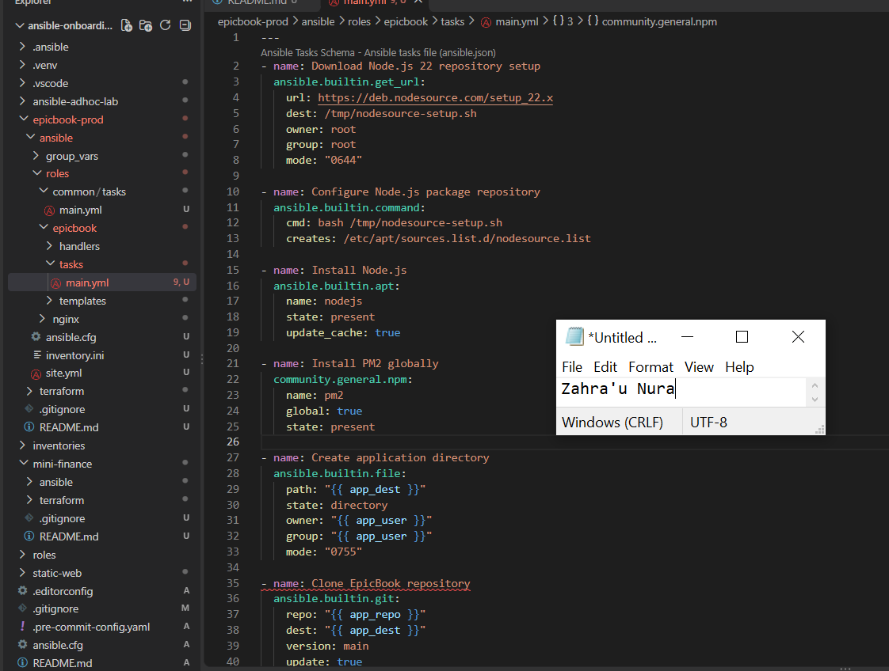

---

#### Screenshot 16 — Task or file showing how the database connection is configured, with secrets hidden

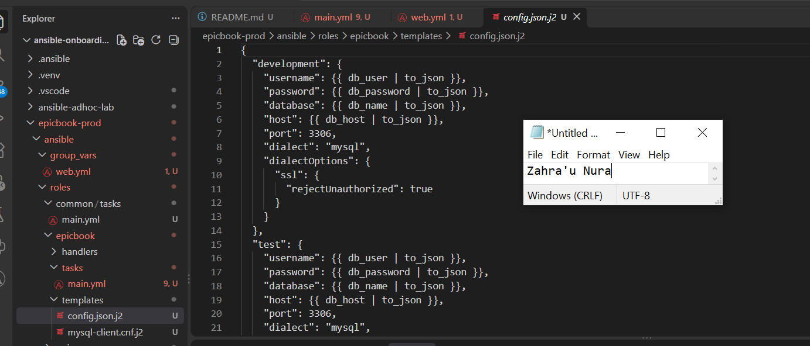

---

#### Screenshot 17 — Task or output showing the EpicBook application managed by PM2

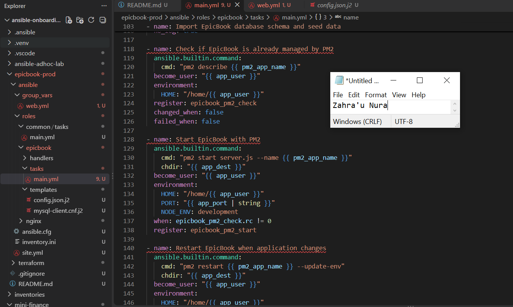

---

### Notes

Answer the following in your own words:

**1. What is the responsibility of the `epicbook` role?**

It deploys EpicBook, installs Node.js dependencies, configures MySQL, imports database scripts, and manages the application using PM2.

---

**2. Why is PM2 used for the EpicBook Node.js application?**

PM2 manages the Node.js process, keeps it running in the background, and supports restarting it when needed.

---

**3. Why should database passwords not be hard-coded in public files?**

Hard-coded passwords can be exposed through source control, creating serious security risks.

---

**4. What does it mean for the application to run on port `8080` while Nginx listens on port `80`?**

Nginx handles incoming web traffic on port 80 and forwards requests internally to EpicBook on port 8080.

---

# Task 9 — Create Group Variables

## Goal

Create reusable variables for the EpicBook deployment.

The `group_vars/web.yml` file stores values that can be reused across the Ansible roles.

### Evidence

#### Screenshot 18 — `group_vars/web.yml` showing the application, PM2, and database variables, with passwords hidden or masked

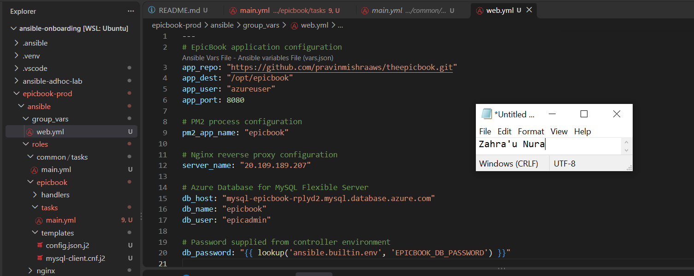

---

### Notes

Answer the following in your own words:

**1. What is the purpose of `group_vars/web.yml`?**

It stores reusable configuration variables shared by the Ansible roles managing the web server.

---

**2. Which values did you store in `group_vars/web.yml`?**

Application repository, installation path, application user, port 8080, PM2 name, Nginx server name, and MySQL connection settings.

---

**3. How did you handle the database password securely?**

I configured Ansible to retrieve the password from the EPICBOOK_DB_PASSWORD environment variable instead of storing it in plaintext.

---

# Task 10 — Run the Ansible Playbook

## Goal

Run the Ansible playbook to configure the VM and deploy the EpicBook application.

The playbook should run the roles in this order:

1. `common`
2. `nginx`
3. `epicbook`

### Evidence

#### Screenshot 19 — Ansible playbook output showing the roles running

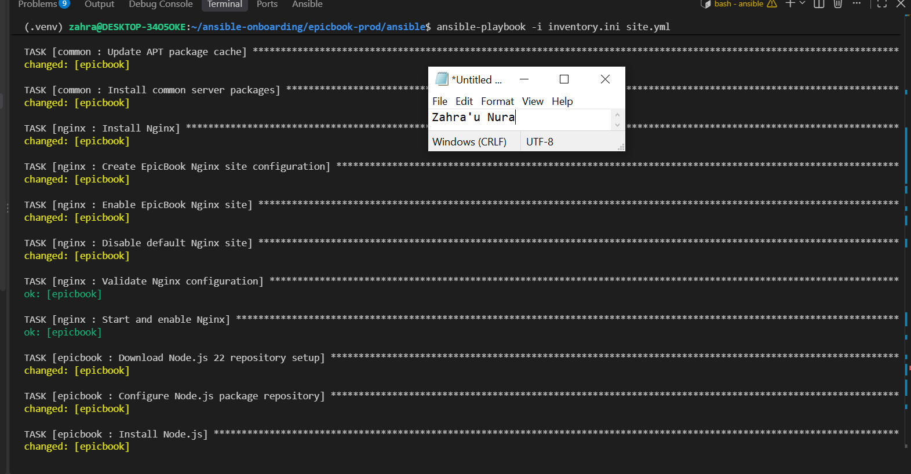

---

#### Screenshot 20 — Final Ansible recap showing `failed=0`

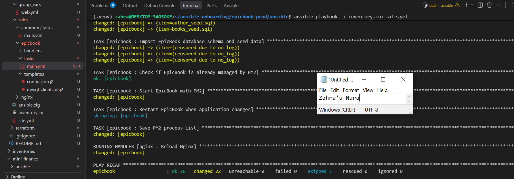

---

#### Screenshot 21 — Output of `ansible web -i inventory.ini -m command -a "systemctl is-active nginx" --become`

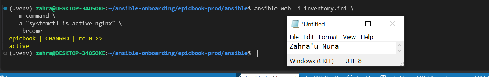

---

#### Screenshot 22 — Output of `ansible web -i inventory.ini -m command -a "pm2 status"`

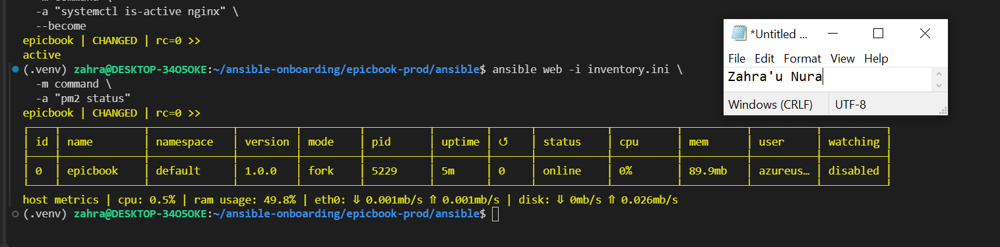

---

#### Screenshot 23 — Output of `ansible web -i inventory.ini -m command -a "curl -I http://localhost:8080"`

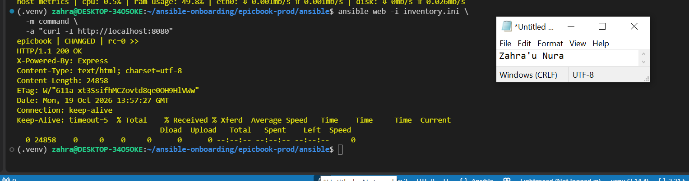

---

### Notes

Answer the following in your own words:

**1. What command did you run to execute the Ansible playbook?**

ansible-playbook -i inventory.ini site.yml.

---

**2. How do you know all roles completed successfully?**

The final Ansible play recap should show failed=0 and unreachable=0.

---

**3. What proves that Nginx is active?**

Running systemctl is-active nginx on the VM returns active.

---

**4. What proves that PM2 is managing the EpicBook application?**

Running pm2 status shows the epicbook process with status online.

---

**5. What proves that the EpicBook application responds on port `8080`?**

Running curl -I http://localhost:8080 on the VM returns a successful HTTP response.

---

# Task 11 — Verify the EpicBook Deployment

## Goal

Verify that the EpicBook application is running, accessible in the browser, and connected to the managed MySQL database.

### Evidence

#### Screenshot 24 — Output of `curl -I http://<public_ip>`

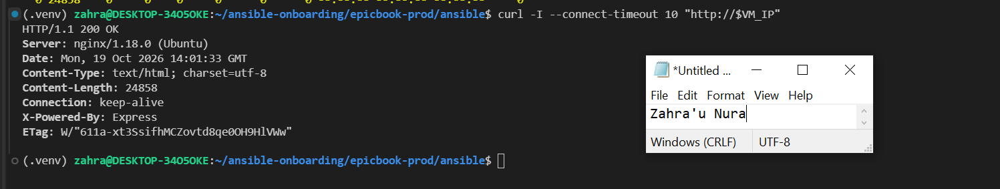

---

#### Screenshot 25 — Output of the cart API test command

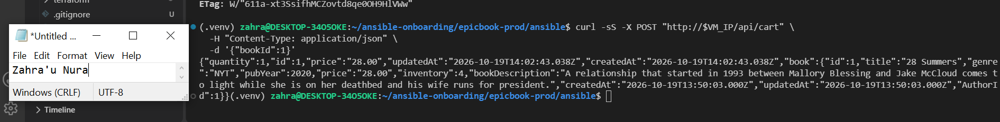

---

#### Screenshot 26 — Output of the `/cart` HTTP status check

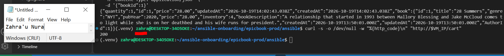

---

#### Screenshot 27 — Browser showing the EpicBook application loaded from `http://<public_ip>`

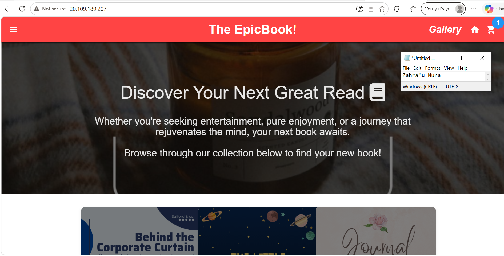

---

### Notes

Answer the following in your own words:

**1. What HTTP response did you receive from the public application URL?**

The expected successful response is HTTP/1.1 200 OK, confirming the application is accessible through Nginx.

---

**2. What did the cart API test prove?**

A successful cart API test demonstrates that the application can process cart requests and interact with its database.

---

**3. What did the `/cart` status check return?**

The expected result is HTTP status code 200, indicating the cart page is accessible.

---

**4. What issue did you face during verification, and how did you fix it?**

During infrastructure deployment, Terraform marked the Azure VNet as tainted after a provisioning error. I confirmed that the VNet was healthy, cleared the tainted status, and prepared a new Terraform plan to continue deployment.

---

# LinkedIn Post Required

## Evidence

#### LinkedIn Post URL

Paste your LinkedIn post URL here:

`https://www.linkedin.com/posts/zahra-u-nura_dmibypravinmishra-devops-terraform-ugcPost-7518028980810170370-l7Uz/?utm_source=share&utm_medium=member_desktop&rcm=ACoAABhheJ4Bw5LI3hMBUfCD5MZiGRXdKYKjr0U`

---

#### Screenshot — Published LinkedIn post

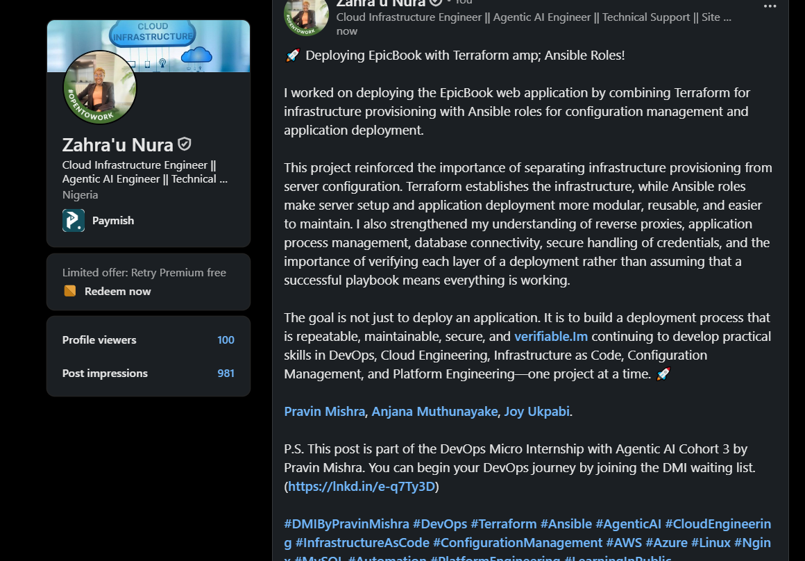

---

# Assignment Questions

Answer the following in your own words:

**1. Why is Terraform used for infrastructure provisioning?**

Terraform automates cloud resource creation using code, making infrastructure consistent, repeatable, and easier to manage.

---

**2. Why are Ansible roles useful for production-style deployments?**

Roles organize automation into reusable components, making deployments easier to maintain, test, and troubleshoot.

---

**3. What is the purpose of `group_vars/web.yml`?**

It provides shared configuration variables for the web server and EpicBook application roles..

---

**4. Why should database passwords not be committed to GitHub?**

Exposed passwords could allow unauthorized users to access or compromise the database.

---

**5. What is the purpose of Nginx in this deployment?**

Nginx acts as a reverse proxy, forwarding public web requests to the EpicBook Node.js application.

---

**6. Why should the managed MySQL database not be publicly accessible?**

Restricting database access to private networking reduces exposure to unauthorized connections and attacks.

---

**7. Why is PM2 used for the EpicBook Node.js application?**

PM2 manages the application process, supports automatic restarts after crashes, and helps maintain availability.

---

**8. What does idempotency mean in Ansible?**

Idempotency means repeatedly running the same playbook maintains the desired configuration without making unnecessary changes.

---

**9. What issue did you face during the deployment, and how did you fix it?**

Terraform encountered a VNet provisioning error after I recreated the resource group in West US 2. I verified the Azure VNet was healthy and used Terraform's untaint recovery approach to avoid unnecessary replacement.

---

**10. What security improvement would you make before using this setup in production?**

I would enable HTTPS using TLS certificates, enforce SSH host-key verification, and store database credentials in Azure Key Vault.

---

# Required Files

Confirm that the following files are included in your GitHub repository or assignment folder:

- [ ] `README.md`
- [ ] Terraform files under either `terraform/azure/` or `terraform/aws/`
- [ ] `ansible/ansible.cfg`
- [ ] `ansible/inventory.ini`
- [ ] `ansible/site.yml`
- [ ] `ansible/group_vars/web.yml`
- [ ] `ansible/roles/common/tasks/main.yml`
- [ ] `ansible/roles/nginx/tasks/main.yml`
- [ ] `ansible/roles/nginx/templates/epicbook.conf.j2`
- [ ] `ansible/roles/epicbook/tasks/main.yml`

---

# Submission Instructions

- Add all required screenshots in your submission.
- Full Name must be visible in required screenshots.
- Mention the cloud provider used: Azure or AWS.
- Add the VM public IP address.
- Add the final application URL.
- Add Terraform output proof.
- Add Ansible role tree proof.
- Add all required notes and assignment question answers.
- Add your LinkedIn post URL.
- Do not expose SSH private keys, passwords, cloud credentials, database credentials, Terraform state files, subscription IDs, or account IDs.

---

# Completion Checklist

- [ ] Task 1: Project folder layout created
- [ ] Task 2: Terraform infrastructure provisioned
- [ ] Task 3: SSH key-based access verified
- [ ] Task 4: Ansible inventory and configuration created
- [ ] Task 5: Main Ansible playbook created
- [ ] Task 6: `common` role created
- [ ] Task 7: `nginx` role created
- [ ] Task 8: `epicbook` role created
- [ ] Task 9: Group variables created
- [ ] Task 10: Ansible playbook run completed
- [ ] Task 11: EpicBook deployment verified
- [ ] Terraform files created under only one cloud provider folder
- [ ] One Ubuntu VM was created
- [ ] One managed MySQL database was created
- [ ] SSH port `22` is restricted to the controller public IP
- [ ] HTTP port `80` is accessible
- [ ] MySQL port `3306` is not publicly open
- [ ] `ansible web -i inventory.ini -m ping` returns `SUCCESS`
- [ ] `site.yml` calls the roles in the correct order
- [ ] Database secrets are hidden or handled securely
- [ ] Nginx is active
- [ ] PM2 shows the EpicBook application running
- [ ] EpicBook responds on port `8080`
- [ ] Public URL loads in the browser
- [ ] Cart API verification works
- [ ] Playbook completes with `failed=0`
- [ ] Screenshots 1–27 are included
- [ ] Assignment questions are answered
- [ ] LinkedIn post published
- [ ] LinkedIn post URL added
- [ ] No sensitive information is exposed

---

## About DMI & CloudAdvisory

DevOps Micro Internship (DMI) is a project-based DevOps program run by Pravin Mishra and The CloudAdvisory, focused on real-world execution, systems thinking, and career readiness.

It helps learners build strong DevOps foundations with hands-on experience.

---

## Resources

- DMI Official Website: [https://dmi.pravinmishra.com?utm_source=github&utm_medium=readme](https://dmi.pravinmishra.com?utm_source=github&utm_medium=readme)
- University: [https://university.pravinmishra.com?utm_source=github&utm_medium=readme](https://university.pravinmishra.com?utm_source=github&utm_medium=readme)
- Discord Community: [https://discord.pravinmishra.com?utm_source=github&utm_medium=readme](https://discord.pravinmishra.com?utm_source=github&utm_medium=readme)
- Blog: [https://dmi.pravinmishra.com/blog?utm_source=github&utm_medium=readme](https://dmi.pravinmishra.com/blog?utm_source=github&utm_medium=readme)
- YouTube Playlist: [https://www.youtube.com/playlist?list=PLFeSNDtI4Cho](https://www.youtube.com/playlist?list=PLFeSNDtI4Cho)
- Pravin Mishra LinkedIn: [https://www.linkedin.com/in/pravin-mishra-aws-trainer/](https://www.linkedin.com/in/pravin-mishra-aws-trainer/)
- CloudAdvisory LinkedIn: [https://www.linkedin.com/company/thecloudadvisory/](https://www.linkedin.com/company/thecloudadvisory/)

---

*This submission is part of DevOps Micro Internship (DMI) — Agentic AI Track.*