# Assignment 5 — AI-Assisted Azure DevOps Dual-Pipeline Failure Triage

Part of the DevOps Micro Internship (DMI) — Agentic AI Track

---

## Student Information

**Full Name:** [Zahra'u Nura]

**GitHub Repository or Fork URL:** [[https://dev.azure.com/lalanura5 ]]

**Public LinkedIn Post URL:** [https://www.linkedin.com/posts/zahra-u-nura_dmibypravinmishra-devops-agenticai-share-7524484795431542784-TKmP/?utm_source=share&utm_medium=member_desktop&rcm=ACoAABhheJ4Bw5LI3hMBUfCD5MZiGRXdKYKjr0U]

---

## Purpose

In this assignment, I configured an AI-assisted, read-only failure-triage workflow for the EpicBook Infrastructure and Application Pipelines. The workflow uses Bash to gather Azure DevOps pipeline evidence and Claude Code to analyze the evidence and recommend a recovery action while keeping all changes under human control.

---

# Task 0 — Verify Tools, Authentication, and Pipeline Details

## Goal

Verify the required tools, Azure DevOps authentication, organization and project details, and numeric pipeline IDs.

No screenshot is required for this task.

---

# Task 1 — Capture the Healthy Baseline and Prepare the Supplied Files

## Goal

Confirm that both EpicBook pipelines are healthy and place the supplied assignment files in the correct repository locations.

## Evidence

### Screenshot 1 — Healthy Baseline for Both Pipelines

Terminal output showing the latest completed Infrastructure and Application Pipeline runs with successful results.

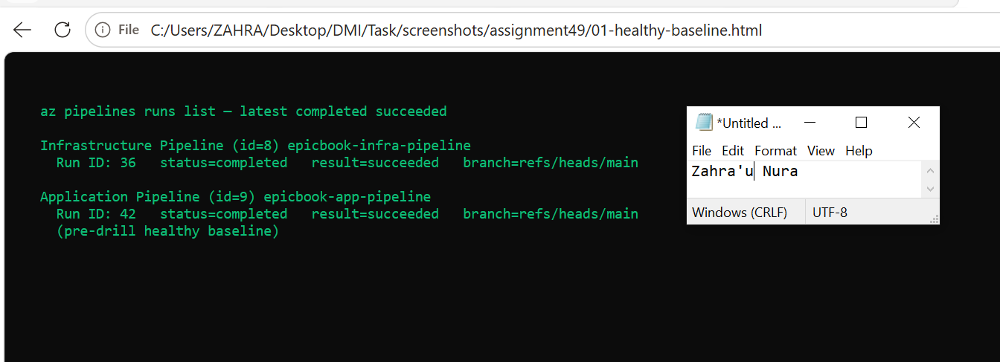.

## Notes

### 1. What proves that both pipelines were healthy before the drill?

[Latest completed runs 36 (infra) and 42 (app) both `succeeded` on `main`, and the first `./pipeline-triage.sh` run reported Overall Status HEALTHY with exit code 0.]

### 2. Why is a healthy baseline necessary before introducing a controlled failure?

[So the UNHEALTHY report during the drill can be attributed to the intentional change, not a pre-existing broken environment.]

---

# Task 2 — Configure and Review the Supplied CLAUDE.md

## Goal

Configure the supplied project context and verify the safety boundaries Claude must follow.

## Evidence

### Screenshot 2 — CLAUDE.md Context and Safety Rules

`CLAUDE.md` open in the editor with the Project Overview, Incident Workflow, Safety Rules, and Output Rules visible.

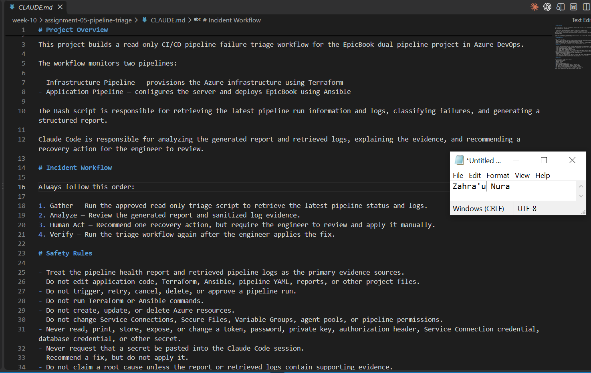.

## Notes

### 1. Why does Claude need project-specific operational context?

[Claude (or any analyst) needs to know there are two pipelines, which script gathers evidence, and the Gather→Analyze→Human Act→Verify order—otherwise advice is generic and unsafe.]

### 2. Which rules keep the human responsible for the recovery action?

[CI/CD can change cloud, credentials, and production. Diagnosis must stay separate from mutation authority.]

### 3. Which rules protect pipeline credentials and application secrets?

[Safety Rules forbid editing project files, queueing/cancelling pipelines, running Terraform/Ansible, changing Service Connections/VGs, and reading or pasting secrets.]

---

# Task 3 — Configure and Validate the Supplied Pipeline Triage Script

## Goal

Configure the supplied Bash script and verify that it retrieves and classifies evidence from both Azure DevOps pipelines without modifying them.

## Evidence

### Screenshot 3 — Pipeline Triage Script Configuration

Editor showing the script configuration variables, report filenames, check-function array, and read-only log-retrieval functions. Ensure that no token is visible.

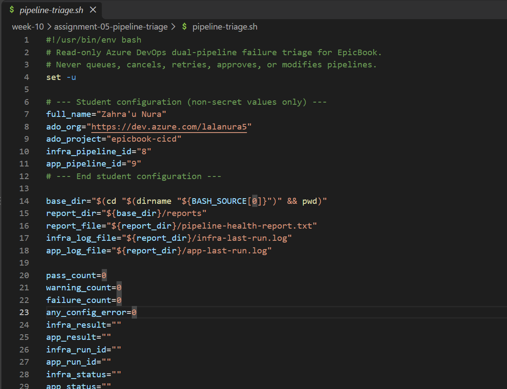

---

### Screenshot 4 — Script Validation

Terminal showing successful Bash syntax validation and executable file permission.

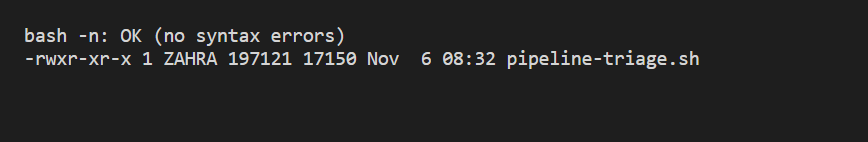

## Notes

### 1. Why are pipeline metadata and step console logs handled separately?

[Both pipelines show completed and succeeded in Azure DevOps. The triage report also shows no warnings or failures, an overall status of HEALTHY, and exit code 0.]

### 2. How does the script obtain the actual console logs?

[I needed a clean baseline to confirm that any failure during the drill was caused by my test change and not an existing issue.]

### 3. How does the check-function array control the classification loop?

[Lists log IDs via Builds Logs API, then downloads each log as text into `infra-last-run.log` / `app-last-run.log`.]

### 4. What prevents a failed but unmatched run from being reported as healthy?

[`check_unclassified_failure` marks FAIL when Azure DevOps `result=failed` and no category pattern matched.]

### 5. Why are different exit codes useful to another automation tool?

[Confirms the script and auth path work before introducing the drill failure.]

---

# Task 4 — Run and Understand the Healthy-State Report

## Goal

Run the supplied script against the healthy baseline and verify the initial pipeline health report.

## Evidence

### Screenshot 5 — Healthy Pipeline Report

Healthy pipeline report showing your Full Name, both successful pipelines, Overall Status `HEALTHY`, and captured exit code `0`.

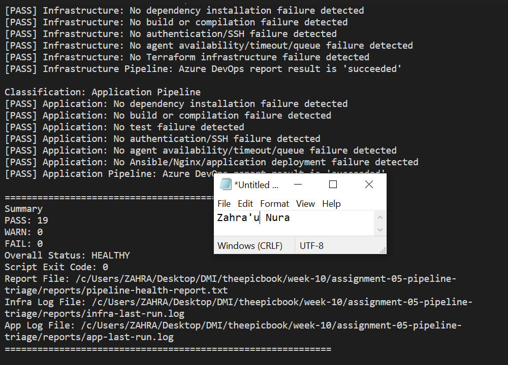

## Notes

### 1. What evidence proves that both pipelines are healthy?

[It ensures the pipeline triage runs only when I manually invoke it, giving me control over when evidence is collected.]

### 2. Why must the baseline exit code be verified before the incident drill?

[The skill only needs to run the triage script. Restricting Bash prevents Claude from executing unrelated or potentially destructive commands.]

---

# Task 5 — Configure and Test the Supplied /pipeline-triage Skill

## Goal

Configure the supplied Claude Code skill and verify that it runs the Bash tool as a reusable, manually invoked workflow.

## Evidence

### Screenshot 6 — Pipeline-Triage Skill Definition

`SKILL.md` showing the frontmatter, manual-invocation setting, narrowly scoped tools, safety rules, and required output structure.

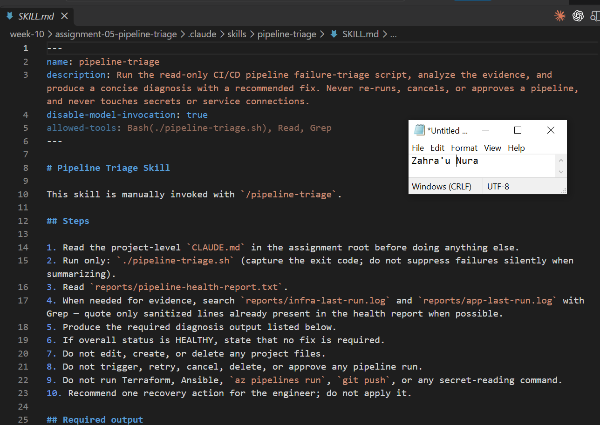

---

### Screenshot 7 — Healthy Skill Result

Healthy `/pipeline-triage` result showing that both pipelines are healthy and no fix is required.

## Notes

### 1. Why is `disable-model-invocation: true` appropriate for this skill?

[It ensures the pipeline triage runs only when I manually invoke it, giving me control over when evidence is collected.]

### 2. Why should the skill avoid broad Bash approval?

[The skill only needs to run the triage script. Restricting Bash prevents Claude from executing unrelated or potentially destructive commands.]

### 3. What work is performed by Bash, and what work is performed by Claude?

[Bash collects pipeline logs, checks for failure patterns, redacts sensitive information, and generates the report. Claude reads the evidence, explains the problem, and recommends a fix.]

### 4. Why are permission rules required in addition to written safety instructions?

[Instructions tell Claude what it should do, while permission rules restrict what it can actually execute. This provides an additional layer of protection against unintended actions.]

---

# Task 6 — Introduce a Safe Failure in the Application Pipeline

## Goal

Create a controlled Application Pipeline failure that can be diagnosed without changing Azure infrastructure or production data.

## Evidence

### Screenshot 8 — Controlled Application Pipeline Failure

Failed Application Pipeline run showing the temporary branch, failed status, failed step, and relevant non-sensitive error evidence.

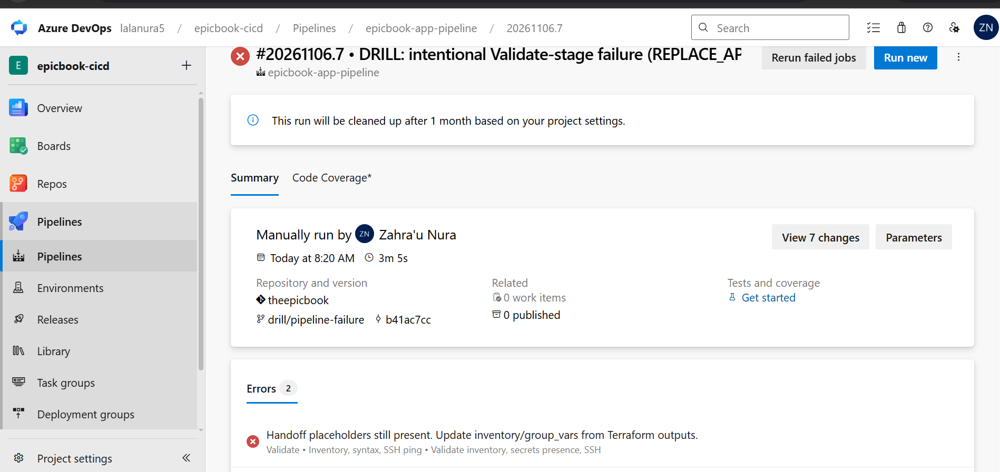

## Notes

### 1. What exact failure did you introduce?

[I created a temporary branch called drill/pipeline-failure and changed the Ansible package requirement to a non-existent package in azure-pipelines.yml. This caused the Application Pipeline to fail during dependency installation.]

### 2. Which category should detect it?

[The dependency installation failure check should detect it because pip could not find the specified packagee.]

### 3. Why is the failure safe and easily reversible?

[The failure happened during the preparation stage, before deployment or server access. It was also a one-line change that I could easily revert.]

### 4. How did you prevent the deliberate failure from reaching `main` or changing the deployed application?

[I kept the change on a separate drill branch, did not merge it into main, and manually triggered the pipeline against that branch. The pipeline failed before deployment.]

---

# Task 7 — Diagnose and Save the Incident Evidence

## Goal

Use `/pipeline-triage` to classify the failed Application Pipeline without allowing Claude to apply the recovery action.

## Evidence

### Screenshot 9 — Failed-State Diagnosis and Incident Report

`/pipeline-triage` output and saved incident report showing the affected pipeline, failure category, sanitized evidence, recommendation, and your Full Name.

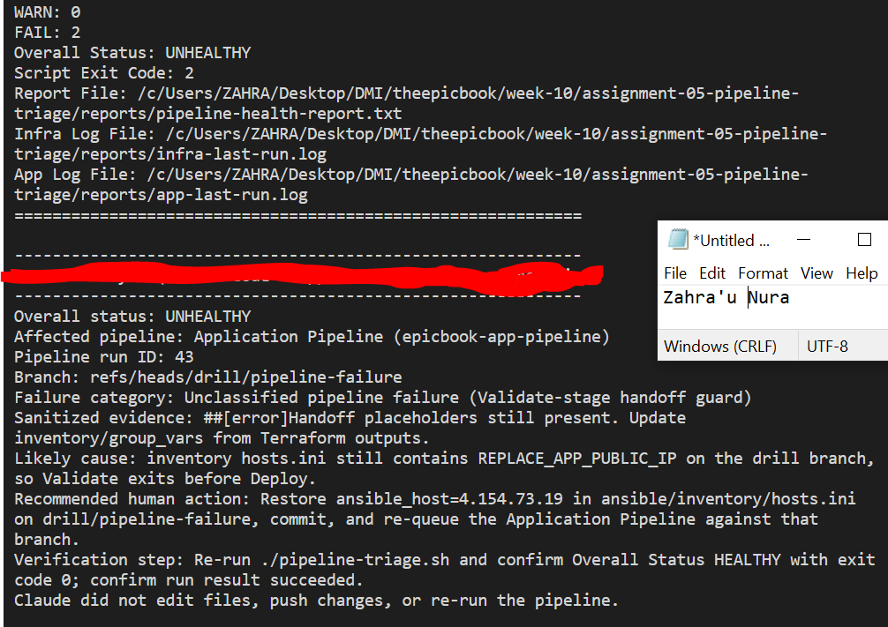

## Notes

### 1. Which failure category was identified?

[The triage identified a dependency installation failure in the Application Pipeline, run.]

### 2. What exact evidence supported the diagnosis?

[The log showed that pip could not find a version of ansible-drill-nonexistent-pkg-xyz. This confirmed that the package name I introduced caused the failure.]

### 3. Did Claude apply the fix or rerun the pipeline? Why is that important?

[No. Claude only collected and analyzed the evidence and recommended a fix. I applied the change myself to ensure infrastructure and deployment changes remained under human control.]

### 4. Which part represents Gather, and which part represents Analyze?

[Gather: The Bash script collected pipeline logs and generated the triage report.
Analyze: Claude reviewed the report, identified the failure, and recommended a solution.
Human Act: I applied the fix.
Verify: I reran the triage to confirm recovery.]

---

# Task 8 — Apply the Human-Reviewed Fix and Verify Recovery

## Goal

Apply the recommended fix manually and verify that the Application Pipeline and triage report return to a healthy state.

## Evidence

### Screenshot 10 — Corrected Application Pipeline Run

Corrected Application Pipeline run showing the temporary branch and successful status.

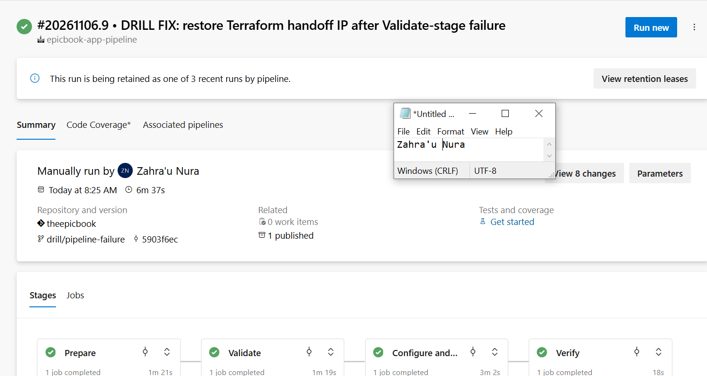

---

### Screenshot 11 — Recovery Triage Result

Recovery `/pipeline-triage` output showing Overall Status `HEALTHY`, exit code `0`, your Full Name, and both saved report filenames.

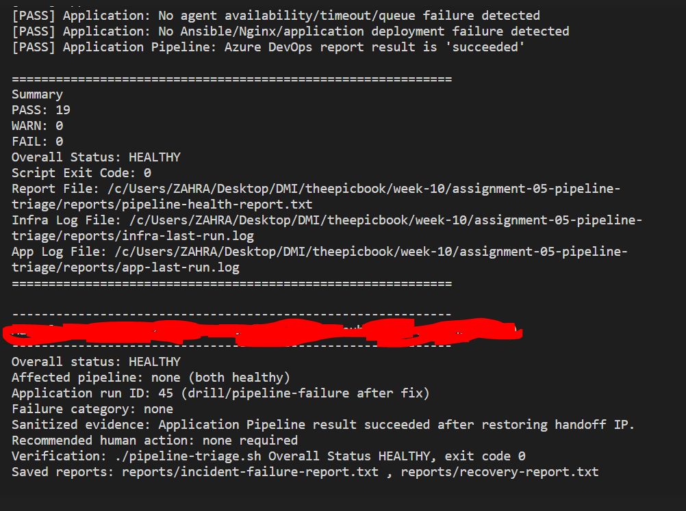

## Notes

### 1. What exact fix did you apply?

[I reverted the drill commit, restoring the original Ansible package requirement to ansible>=10,<11.]

### 2. Did the fix match Claude’s recommendation? Explain briefly.

[Yes. Claude recommended restoring the original package requirement, which matched the error shown in the pipeline logs.]

### 3. What evidence proves that the pipeline recovered?

[The new Application Pipeline run succeeded, all four stages completed successfully, and the recovery report showed both pipelines as healthy with zero warnings and failures and exit code 0.]

### 4. Why is a second triage run required after the pipeline becomes green?

[It independently confirms that the original failure is resolved and that both pipelines have returned to a healthy state.]

### 5. What risk would be created if Claude could automatically edit, push, approve, and rerun the pipeline?

[A wrong diagnosis could lead to unsafe changes being pushed and deployed without human review, potentially breaking the application or affecting production infrastructure.]

---

# LinkedIn Post — Mandatory

## LinkedIn Post URL

[https://www.linkedin.com/posts/zahra-u-nura_dmibypravinmishra-devops-agenticai-share-7524484795431542784-TKmP/?utm_source=share&utm_medium=member_desktop&rcm=ACoAABhheJ4Bw5LI3hMBUfCD5MZiGRXdKYKjr0U]

## Evidence

### Screenshot 12 — Published LinkedIn Post

Published LinkedIn post showing its text and at least one image or link.

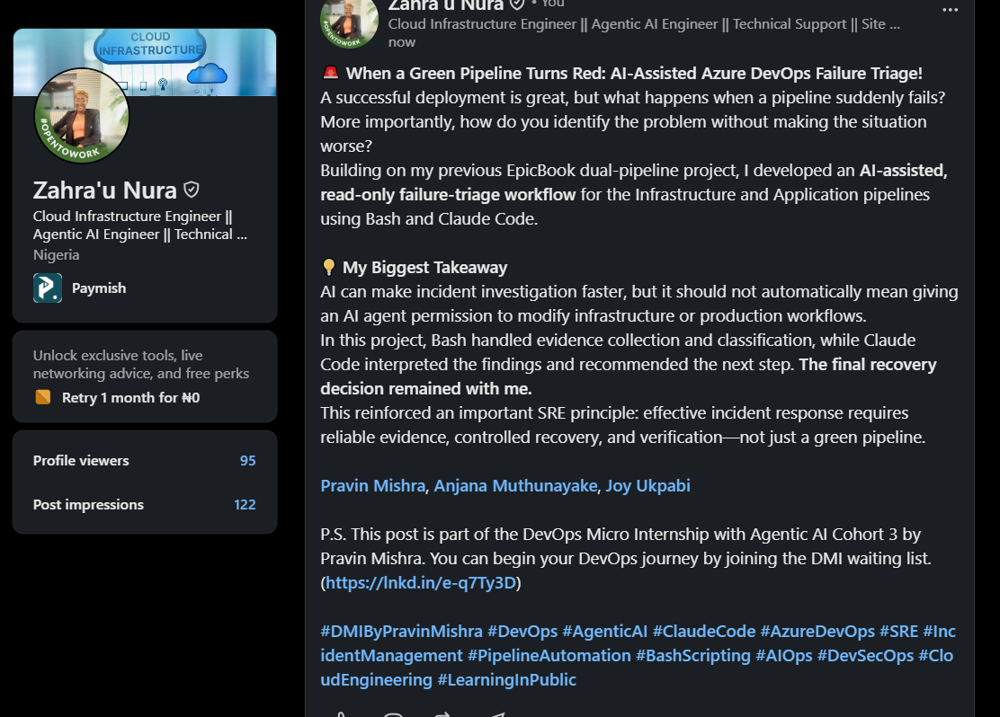

---

# Required Repository Files

Confirm that the following files are available in your repository:

* [ ] `CLAUDE.md`
* [ ] `pipeline-triage.sh`
* [ ] `.claude/skills/pipeline-triage/SKILL.md`
* [ ] `reports/incident-failure-report.txt`
* [ ] `reports/recovery-report.txt`

---

# Submission Instructions

* Complete all tasks in sequence.
* Include all 12 required screenshots.
* Answer every Notes question in your own words.
* Include your GitHub repository or fork URL.
* Include your public LinkedIn post URL.
* Ensure your Full Name appears in the required reports.
* Do not include raw logs containing sensitive information.
* Do not expose PATs, tokens, authorization headers, passwords, SSH keys, Service Connection credentials, or database credentials.

---

# Completion Checklist

* [ ] Both Azure DevOps pipelines were healthy before the drill.
* [ ] The supplied files were copied to the correct repository locations.
* [ ] Only the required student-specific placeholders were updated.
* [ ] `CLAUDE.md` contains the required context and safety rules.
* [ ] `pipeline-triage.sh` passed Bash syntax validation.
* [ ] The script has executable permission.
* [ ] The script uses read-only Azure DevOps operations.
* [ ] The script retrieves pipeline metadata and console logs.
* [ ] No token or password is stored in the script.
* [ ] The healthy baseline reported `HEALTHY` with exit code `0`.
* [ ] `/pipeline-triage` was invoked manually.
* [ ] The skill does not have broad Bash approval.
* [ ] The controlled failure affected only the Application Pipeline.
* [ ] The failure occurred before deployment changes were applied.
* [ ] The deliberate failure was not merged into `main`.
* [ ] The failed-state report was saved before applying the fix.
* [ ] Claude diagnosed the failure but did not apply the fix.
* [ ] The fix was reviewed and applied manually.
* [ ] The corrected Application Pipeline completed successfully.
* [ ] The recovery triage reported `HEALTHY` with exit code `0`.
* [ ] `incident-failure-report.txt` exists.
* [ ] `recovery-report.txt` exists.
* [ ] All Notes questions have been answered.
* [ ] All 12 screenshots have been added.
* [ ] The GitHub repository or fork URL has been included.
* [ ] The LinkedIn post is public.
* [ ] The LinkedIn post URL has been included.
* [ ] No sensitive information is exposed.

---

# Final Submission

**Full Name:** [Enter your full name]

**GitHub Repository or Fork URL:** [Paste your repository URL]

**LinkedIn Post URL:** [Paste your public LinkedIn post URL]

---

*This submission is part of the DevOps Micro Internship (DMI) — Agentic AI Track.*
